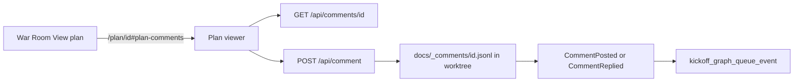

# Comment read API and War Room wiring

## Parent Epic

[epic_002](../../epics/2_active/epic_002_plan_view_review_threads.md) — Plan-view review threads.

Cites (promote to frontmatter `cites:` when feat_019 lands): `epic_002#macro-architecture`, `epic_002#core-dependencies`, `epic_002#cross-module-constraints`.

Constraints this feature must honor:

- Filesystem is truth. Comments stay in `docs/_comments/{doc_id}.jsonl` (feat_005 / DESIGN §10.3). Do not write into the plan `.md` body.
- Localhost only. Routes stay on `127.0.0.1`.
- Pointer epics (dec_005): all comment reads/writes resolve through `resolve_doc_worktree` (already in `cascade.comments.store`). Trunk pointers never get their own sidecar.
- Existing GET `/api/comments/{doc_id}` and POST `/api/comment` already persist and toast. This feature extends them; it does not add a second store or a second read API.
- Blocking remains human-only on create, default `false` (dec_002). Agents still cannot set it.
- Kickoff edges only: posting or replying enqueues `CommentPosted` / `CommentReplied`. Do not add timer polling.

## Scope

**In**

- Treat GET `/api/comments/{doc_id}` as the locked read API. Keep the current 404 (unknown id) and 400 (task-tier) behavior. Return the new optional fields below; older sidecar rows omit them and deserialize as null / empty.
- Extend `cascade.comments.types.Comment` and POST `/api/comment` so a root comment may store `line_start`, `line_end`, `doc_sha`, and `blocks` (`list[work_id]`, default empty). `section` and `anchor` stay required/optional as today. `section` is stored as the shared slug (see `section_slug()`), not the raw heading text.
- When POST `/api/comment` includes `parent`, treat it as a human in-thread reply: call existing `reply_comment` (emits `CommentReplied`). Ignore `blocking`, `line_*`, `doc_sha`, and `blocks` on replies. Do not add a second reply URL.
- Add `section_slug(heading: str) -> str` in `cascade/comments/` (one function, imported by the plan viewer and the dispatch gate). Heading rename that breaks a `cites:` entry is reported later by feat_019, not here.
- War Room: point the existing **View plan** control at `/plan/{id}#plan-comments` for epic and feature rows. No second compose form and no extra Comments button. Toasts on new human comments when not attached stay as they are.
- POST `/api/comment` keeps the existing `kickoff_graph_queue_event` call so one owning-graph turn is requested for both roots and replies.

**Out**

- Line-level gutter, text-selection, re-anchor, and outdated chrome (feat_017).
- Resolve HTTP, human-only resolve enforcement, and `record_decision` linkage (feat_018).
- Dispatch / mint / merge gates and `cites:` frontmatter on `WorkMeta` (feat_019).
- Agent playbook for review turns (feat_020).
- GitHub OAuth, remote PR comments, or a new comment database.
- A new `/api/comment/reply` route.
- Changing `CommentPosted` payload shape beyond adding the new optional keys already stored on the record.

## Data structures

```text
Comment  # extends feat_005; new fields optional for back-compat
  id: "cmt_NNN"
  doc_id: WorkId
  section: str                 # section_slug(nearest heading); never empty on create
  anchor: str | null           # quoted snippet
  line_start: int | null       # 1-based source line; null = section/doc-level
  line_end: int | null
  doc_sha: str | null          # spec blob sha at post time
  blocks: [WorkId]             # explicit scope override; empty = use D3 rules later
  author: human | feature_lead | feature_architect | epic_manager | epic_architect
  body: str
  parent: comment_id | null
  state: open | resolved
  blocking: bool               # default false; human-only to set true
  created: datetime
```

`section_slug(heading)`: trim, lowercase, whitespace to `-`, drop characters outside `[a-z0-9-]`, collapse repeats. `# Memory layout` → `memory-layout`. Empty heading is invalid (store already refuses empty `section`).

## API contracts

```text
GET  /api/comments/{doc_id}
     -> {doc_id, comments: [Comment]}
     404 unknown id; 400 task-tier (unchanged)

POST /api/comment
     {doc_id, section, body, anchor?, blocking?=false,
      line_start?, line_end?, doc_sha?, blocks?, parent?}
     -> 202 {ok, comment_id, kickoff}
     author is always human on this route
     parent omitted: root comment; blocking=true allowed
     parent set: reply via store.reply_comment; blocking/line/sha/blocks ignored
     section is slugified before persist if the client sent a heading (roots only)
     404 if parent is set and missing
```

All binds: `127.0.0.1`. Sidecar path is the owning worktree via `resolve_doc_worktree`.

## Logic flow



## Task breakdown

Feature Team mints after dispatch. Suggested slice:

1. **Comment schema + `section_slug()`** — optional fields on `Comment` / store / `from_dict` back-compat; store tests for old lines without the new keys.
2. **POST field pass-through + parent-as-reply** — extend `_handle_comment`; keep kickoff + toast. API tests on the existing War Room server fixture.
3. **War Room deep-link** — View plan on epic/feature rows goes to `/plan/{id}#plan-comments`.

## Risks & upward questions

- `cites:` frontmatter is not on `WorkMeta` yet. This spec records cites in the body until feat_019 adds the field. Accepted limitation from dec_003.
- Slugifying `section` on write changes the stored string versus today's free-text headings (`"Open questions"` vs `open-questions`). Old rows stay as stored; the gate treats them as unmatched cites and warns (feat_019). Do not rewrite historical sidecars.
- Resolve stays off this feature so feat_018 can make it human-only without a race against agent tools.

## Decision log

- **D1 — No second compose surface.** War Room reuses View plan + `#plan-comments`. A board-side compose form would duplicate the plan viewer and rot again.
- **D2 — Replies use `parent` on POST `/api/comment`.** Extends the existing route; no `/api/comment/reply`.
- **D3 — `section_slug()` lives in `cascade/comments/`.** Viewer (feat_017) and gate (feat_019) import the same function. Epic breakdown listed the slug on the gate feature; the comment store is the single owner so the two consumers cannot drift.
