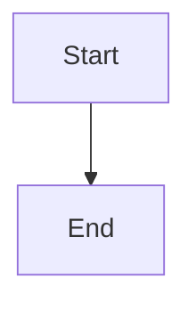

# Comment read API and War Room wiring

## Parent Epic

epic_002

## Scope

Lock and extend the existing comment HTTP API (GET /api/comments/{doc_id}, POST /api/comment) with line/sha/blocks fields, a human reply route, shared section_slug(), and a War Room deep-link to plan-view threads. No second compose form.

## Data structures

TBD.

## API contracts

TBD.

## Logic flow

## Task breakdown

_(empty — Feature Team mints tasks after dispatch)_

## Risks & upward questions

None.

## Decision log

None yet.
