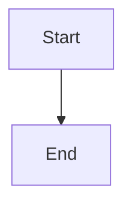

# Serialized queue delivery and monotonic cursor

## Parent Epic

epic_017

## Scope

## Intent

Stop the duplicate-turn loop. Queue ingestion for epic, feature, and task graphs runs only inside the serialized per-graph kickoff job under `_graph_lock`, so a running `graph.invoke` can no longer overwrite the advanced `last_queue_offset` or the ingested event messages.

## Scope

- The watchdog (`deliver_queue_kickoffs`, `kickoff_graph_queue_event`) no longer calls `ingest_queue` directly. It submits a delivery job when the queue file is ahead of the checkpoint cursor.
- At most one pending delivery job per graph. After a turn, the job re-checks the queue once so events that arrived mid-turn get exactly one follow-up.
- Each batch is classified once. Human CommentPosted/CommentReplied events are staged as human messages; non-comment events are staged as event messages; agent replies and CommentResolved schedule nothing. A batch runs at most one model turn.
- A single cursor-write helper refuses to lower the cursor. The only exception is the explicit, logged reset when `read_events` detects a truncated or replaced file.
- No change to queue format or checkpoint schema.

## Acceptance (system-level tests with a counting fake turn runner)

- First task: write a failing reproduction of an append during a blocked in-flight turn that shows the lost cursor and lost messages.
- After the fix: that event is ingested once and the cursor ends at EOF.
- N maintenance ticks on an unchanged queue start zero turns.
- One human comment yields exactly one turn.
- An agent reply or CommentResolved yields zero turns.
- Message order matches queue order.

## Out of scope

Restart resume behavior and stall warnings (next feature).

## Data structures

TBD.

## API contracts

TBD.

## Logic flow

## Task breakdown

_(empty — Feature Team mints tasks after dispatch)_

## Risks & upward questions

None.

## Decision log

None yet.
