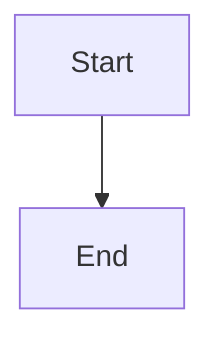

# Restart convergence and stall detection

## Parent Epic

epic_017

## Scope

## Intent

After a supervisor restart, graphs converge to idle. Also make a non-advancing cursor or duplicate kickoff visible before it turns into a loop.

## Scope

- Boot-time `resume_inflight_graphs` and watchdog queue delivery share the serialized per-graph path from feat_017_001. Resume re-checks `snapshot.next` under the lock, so an interrupted turn resumes at most once.
- Already-active graphs whose cursor is behind from before the fix catch up in one bounded delivery, then settle idle. No migration is needed.
- Each delivery is logged with work_id, cursor_before, cursor_after, queue_size, and turn_started.
- A warning fires when a queue stays ahead of its cursor across consecutive maintenance passes with no turn running, or when a kickoff targets a batch offset that was already delivered. Each incident emits one structured log warning and one War Room system note, deduplicated per (work_id, offset).

## Acceptance (system-level tests)

- Simulated restart with an interrupted checkpoint and pending queue lines: bounded model invocations, the cursor ends at EOF, and the final checkpoint is idle (no `next`).
- A forced stall emits exactly one warning across repeated ticks.

## Out of scope

Dashboards, metrics backends, and general watchdog performance work.

## Data structures

TBD.

## API contracts

TBD.

## Logic flow

## Task breakdown

_(empty — Feature Team mints tasks after dispatch)_

## Risks & upward questions

None.

## Decision log

None yet.
