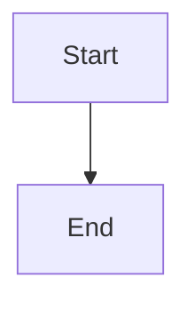

# Restart convergence and stall detection

## Parent Epic

epic_017

## Intent

After a supervisor restart, graphs converge to idle. Also make a non-advancing cursor or duplicate kickoff visible before it turns into a loop.

## Scope

- Boot-time `resume_inflight_graphs` and watchdog queue delivery share the serialized per-graph path from feat_017_001. Resume re-checks `snapshot.next` under the lock, so an interrupted turn resumes at most once.
- Already-active graphs whose cursor is behind from before the fix catch up in one bounded delivery, then settle idle. No migration is needed.
- Each delivery is logged with work_id, cursor_before, cursor_after, queue_size, and turn_started.
- A warning fires when a queue stays ahead of its cursor across consecutive maintenance passes with no turn running, or when a kickoff targets a batch offset that was already delivered. Each incident emits one structured log warning and one War Room system note, deduplicated per (work_id, offset).

## Acceptance (system-level tests)

- Simulated restart with an interrupted checkpoint and pending queue lines: bounded model invocations, the cursor ends at EOF, and the final checkpoint is idle (no `next`).
- A forced stall emits exactly one warning across repeated ticks.

## Out of scope

Dashboards, metrics backends, and general watchdog performance work.

## Data structures

TBD.

## API contracts

TBD.

## Logic flow

## Task breakdown

1. `task_017_002_001`: Serialize boot resume through the per-graph delivery path, with bounded catch-up and delivery logging. Owns the restart convergence acceptance test. No dependencies. **Merged** into `feat/feat_017_002` at `f6efe51`.
2. `task_017_002_002`: Stall and duplicate-kickoff detection with a deduplicated warning and War Room note. Owns the "exactly one warning across repeated ticks" acceptance test. Depends on `task_017_002_001` (satisfied).

## Risks & upward questions

None.

## Decision log

- `dec_001` · 2026-10-22 · Feature Lead · **Task breakdown**
  Chose Two tasks: task_017_002_001 (serialized boot resume, bounded catch-up, delivery logging, restart convergence test), then task_017_002_002 (stall/duplicate-kickoff detection with per-(work_id, offset) dedup and single-warning test). Each task owns its system-level acceptance test; no separate test task. Stall dedup state is in-memory only..
  Rationale: Stall and duplicate-kickoff detection depends on the unified delivery path and its log fields, so it has to come second. Putting each acceptance test with the code it validates avoids a handoff task. Persisting dedup state would cost more than an occasional repeat warning after a restart.
  Honors: feat_017_002 Scope and Acceptance; frugal-engineering test policy.

## Closeout

Completed child work: `task_017_002_001` (Serialize boot resume through per-graph delivery path with bounded catch-up and delivery logging), `task_017_002_002` (Stall and duplicate-kickoff detection with deduplicated warning and War Room note).
