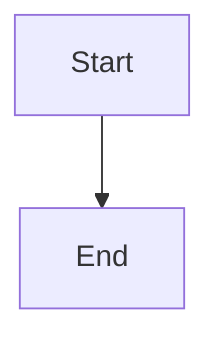

# Submit-only watchdog dispatch and resume-before-stage guard

## Parent Epic

epic_017

## Scope

# Submit-only watchdog dispatch and resume-before-stage guard

## Intent

Close the two epic_017 acceptance-gate items that feat_017_001 merged without (epic dec_009, dec_010, dec_011). Small, surgical change in code feat_017_001 already shipped; no redesign.

## Scope

1. **(b) Watchdog stays submit-only.** Wrap `advance_work(repo)` in `watchdog_tick` (`cascade/watchdog/loop.py`; also the second `advance_work` call near line 189) and the boss-order `dispatch_feature` / `dispatch_task` calls in `cascade/boss/orders.py` in `deferred_kickoffs()` from `cascade/workspace/kickoff.py`. Today `dispatch_*` -> `_boot_after` -> `kickoff_turn` runs a full model turn inline on the watchdog thread. The watchdog thread must never hold or wait on `_graph_lock`.
2. **(c) Resume before any state write.** In `_kickoff_turn` (`cascade/workspace/kickoff.py`), when `_graph_has_inflight_turn(...)` is true for a `comment` / `human_message` job, resume the interrupted turn (`_invoke_role_turn` with no new input) **before** `_stage_human_message`. Then stage the message and run the job's own turn as usual. Use the existing `_graph_has_inflight_turn` (non-empty `snapshot.next` AND a role message on the thread) as the only definition of interrupted; do not use `snapshot.next` alone.

## Acceptance

- One scenario test on the real `SqliteSaver` harness (`tests/harness/queue_delivery.py`, extend `tests/workspace/test_feat_017_queue_cursor_race.py`): a `comment` job landing on an interrupted checkpoint resumes the cut-off turn exactly once, then stages the message and runs exactly one more turn; the human message is present in the final checkpoint.
- One test that `watchdog_tick` with a dispatchable item returns without invoking a model turn on the calling thread (counting fake turn runner; the turn runs on the kickoff drain thread).
- Existing `tests/watchdog/test_watchdog.py` monkeypatches of `deliver_queue_kickoffs` / `kickoff_graph_queue_event` keep working.

## Out of scope

Everything else in epic_017: restart routing and stall warnings are feat_017_002. `invoke_tool` stays lock-free. No changes to the queue format, checkpoint schema, LangGraph topology, or `seed_*_role_models`.

## Sequencing

Should merge before feat_017_002 starts; feat_017_002 relies on the (c) guard for restart convergence.

## Risks & upward questions

- If wrapping `advance_work` in `deferred_kickoffs()` changes observable ordering that existing watchdog tests depend on, raise an epic amendment rather than dropping the wrapper.

## Data structures

TBD.

## API contracts

TBD.

## Logic flow

## Task breakdown

_(empty — Feature Team mints tasks after dispatch)_

## Risks & upward questions

None.

## Decision log

None yet.
