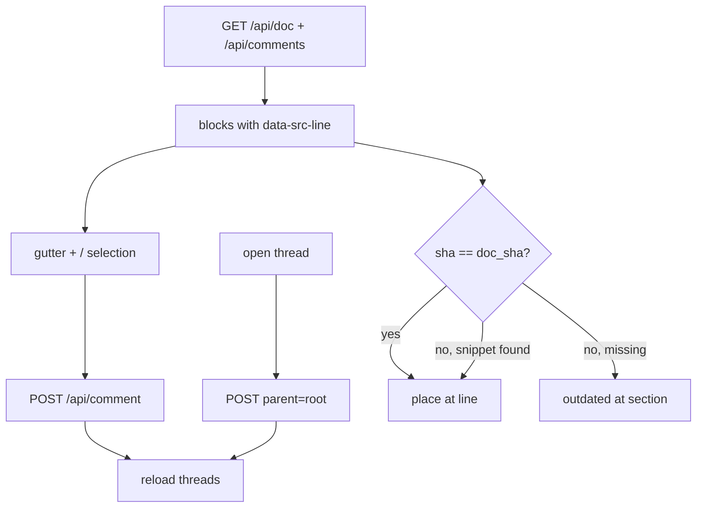

# Plan viewer comment chrome

## Parent Epic

[epic_002](../../epics/2_active/epic_002_plan_view_review_threads.md) — Plan-view review threads.

Depends on: [feat_016](feat_016_comment_read_api_and_war_room_wiring.md).

Cites (promote to frontmatter `cites:` when feat_019 lands): `epic_002#intent`, `epic_002#macro-architecture`, `epic_002#feature-breakdown`.

Constraints this feature must honor:

- Read-only plan renderer (feat_012). Comment chrome is overlay only. No WYSIWYG, no `write_doc` from the viewer.
- Localhost only. Existing `/plan/{id}` shell.
- Filesystem is truth: load/post through feat_016 APIs; never edit the `.md` body to store comments.
- Blocking checkbox unchecked by default (dec_002). Only the human compose path sets it.
- Kickoff edges only: remove the current 3s `setInterval` comment poll in `plan_viewer.js`. Refresh after a successful POST and on page load. A later agent reply appears on the next human refresh or navigation.
- Task plans: comments are not supported (feat_016 returns 400). Hide the review panel; do not show a compose form.
- `section` slugs come from feat_016 `section_slug()`. Do not invent a second slugger.

## Scope

**In**

- Upgrade the existing `#plan-comments` panel (already on `plan_viewer.html`) from a free-text section box to GitHub-style line threads.
- Renderer emits `data-src-line` (1-based) on each block using markdown source maps (token `raw` lengths vs the body string). Implementation may stay in `plan_viewer.js`; do not add a Python markdown dependency.
- Start a root comment from a gutter "+" on a block **or** from a text selection in `#plan-body`. POST `/api/comment` with:
  - `line_start` / `line_end` (source lines),
  - `section` = `section_slug(nearest heading)` (document title if above the first heading),
  - `anchor` = quoted snippet (selection text, or the block's first ~120 chars),
  - `doc_sha` = `GET /api/doc/{id}` sha,
  - `blocking` from the existing checkbox (default off).
- In-thread human reply on each open root: POST `/api/comment` with `parent` set (feat_016). Replies do not set blocking or new line anchors.
- Thread list: group by root `parent=null`; show replies indented (already does). Mark a thread **outdated** when current sha ≠ `doc_sha` and the `anchor` cannot be found inside that `section`. Outdated threads stay visible at the section heading and remain blocking if `blocking`.
- Re-anchor: when sha differs, search `anchor` within the section's current line range and move the gutter marker if found. Do not rewrite the sidecar from the client.
- `#plan-comments` is the hash target for feat_016's View plan deep-link. Keep **Back to War Room** unchanged.
- Show open vs resolved state (CSS already has `.resolved`). The resolve **control** is feat_018; this feature only renders status.

**Out**

- Resolve button, human-only resolve API, decision-log linkage (feat_018).
- Dispatch / mint / merge gates (feat_019).
- Agent review playbook (feat_020).
- A `blocks:` picker in the UI (`blocks` stays API-only in v1).
- In-browser plan editing.
- Commenting on task plans.
- Polling or websocket refresh.
- A second comment store or a War Room compose pane.

## Data structures

```text
PlanCommentChrome   # browser only
  work_id: str
  doc_sha: str | null
  selected: {line_start, line_end, section, anchor} | null
  threads: [Comment]          # from GET /api/comments
  outdated: set[comment_id]   # computed; not persisted
```

No new persistence. Persist shape is feat_016 `Comment`.

## API contracts

Consumes only:

```text
GET  /plan/{id}            existing shell
GET  /api/doc/{id}         existing; sha + body
GET  /api/comments/{id}    feat_016
POST /api/comment          feat_016 (root or parent reply)
```

Client-side helper (same module as the server `section_slug`, or a JS port with a shared test vector): heading → slug. If a JS port is used, a fixture of (heading, slug) pairs must match the Python function.

## Logic flow



## Task breakdown

Feature Team mints after dispatch. Suggested slice:

1. **Source maps + `data-src-line`** — keep Mermaid/markdown behavior; add line metadata. Drop the 3s poll.
2. **Compose from gutter / selection + in-thread reply** — POST the feat_016 fields; keep the blocking checkbox on roots only.
3. **Re-anchor + outdated** — client-only placement; no sidecar rewrite. Thread list shows outdated.

System-level: extend existing plan-viewer tests (route + render) rather than new mock-heavy JS unit tests. One fixture covering re-anchor hit / miss is enough.

## Risks & upward questions

- A JS port of `section_slug` can drift. The shared test vector is mandatory if the function is not served as an API.
- Line numbers after Mermaid replacement can skew if fences are swapped before mapping. Map lines against the **original** body, then attach the attribute to the rendered block for that raw range.
- Agent replies will not appear until the operator reloads. Accepted: epic forbids timer polling.

## Decision log

- **D1 — Resolve button is feat_018.** This feature renders open vs resolved only, so human-only resolve can land without a stub button that agents could race.
- **D2 — No comment poll.** Refresh on load and after POST. Matches kickoff-edges-only.
- **D3 — Task plans hide the panel.** Matches store 400; operator comments on the parent feature or epic.
- **D4 — `blocks:` is API-only.** A multi-select on every comment is gold-plating; section/`cites` covers the common case.
