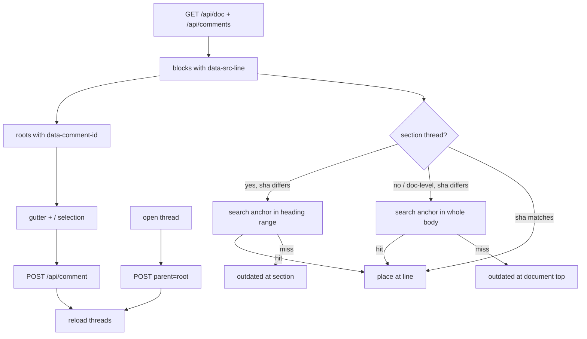

# Plan viewer comment chrome

## Parent Epic

[epic_002](../../epics/2_active/epic_002_plan_view_review_threads.md) — Plan-view review threads.

Depends on: [feat_016](../3_completed/feat_016_comment_read_api_and_war_room_wiring.md) (completed 2026-10-20). Parallel with [feat_018](feat_018_human_resolve_and_audit.md) (dec_014).

Cites (promote to frontmatter `cites:` when feat_019 lands): `epic_002#intent`, `epic_002#macro-architecture`, `epic_002#cross-module-constraints`, `epic_002#feature-breakdown`.

Constraints this feature must honor:

- Read-only plan renderer (feat_012). Comment chrome is overlay only. No WYSIWYG, no `write_doc` from the viewer.
- Localhost only. Existing `/plan/{id}` shell.
- Filesystem is truth: load/post through feat_016 APIs; never edit the `.md` body to store comments.
- Locked read API is GET `/api/comments/{doc_id}` (feat_016 / dec_012). Do not add a second comments list route.
- POST `/api/comment` 202 is `{ok, comment_id}` with **no** `kickoff` key (dec_012 / feat_016 D5). Reload threads after POST; do not wait for an agent turn (feat_020 delivers via watchdog).
- Blocking checkbox unchecked by default (dec_002). Only the human compose path sets it.
- Kickoff edges only: remove the current 3s `setInterval` comment poll in `plan_viewer.js`. Refresh after a successful POST and on page load. A later agent reply appears on the next human refresh or navigation.
- Task plans: comments are not supported (feat_016 returns 400). Hide the review panel; do not show a compose form.
- `section` slugs come from feat_016 `cascade.comments.section_slug`. Do not invent a second slugger and do not import the amendment/filename sluggers.
- Doc-level vs section (dec_008): nearest `##+` heading → section thread; above the first H2 → H1 slug (or `general` if no H1) → doc-level. Never POST an empty `section`.
- Shared root marker (dec_014): each root thread in `#plan-comments` is an element with `data-comment-id` equal to that root's id. feat_018 binds Resolve to open roots. Re-renders must keep the attribute; do not require feat_018 to have landed first, and do not wipe a Resolve control feat_018 already mounted.
- Pointer epics (dec_005): `GET /api/doc/{id}` and `GET /api/comments/{id}` already resolve to the worktree. Line numbers and `doc_sha` are against that body, never a trunk pointer stub.

## Scope

**In**

- Upgrade the existing `#plan-comments` panel (already on `plan_viewer.html`) from a free-text section box to GitHub-style line threads. Remove the free-text Section input; compose is gutter or selection only.
- Renderer emits `data-src-line` (1-based) on each block using markdown source maps (token `raw` lengths vs the body string). Implementation may stay in `plan_viewer.js`; do not add a Python markdown dependency.
- Start a root comment from a gutter "+" on a block **or** from a text selection in `#plan-body`. POST `/api/comment` with:
  - `line_start` / `line_end` (source lines),
  - `section` = `section_slug(nearest ##+ heading)` or H1/`general` when above the first H2,
  - `anchor` = quoted snippet (selection text, or the block's first ~120 chars),
  - `doc_sha` = `GET /api/doc/{id}` sha,
  - `blocking` from the existing checkbox (default off).
- In-thread human reply on each open root: POST `/api/comment` with `parent` set (feat_016). Replies send `doc_id`, `body`, `parent` only — no section, blocking, or line fields.
- Thread list: group by root `parent=null`; show replies indented (already does). Each root node has `data-comment-id="{root id}"`. Mark a thread **outdated** when current sha ≠ `doc_sha` and the `anchor` cannot be found in the search range below. Outdated threads stay visible at the section heading (or document top if doc-level) and remain blocking if `blocking`.
- Re-anchor (client-only; do not rewrite the sidecar):
  - **Section thread** (`section` matches a current `##+` heading): search `anchor` within that heading's current line range.
  - **Doc-level thread** (H1 / `general` / unmatched): search `anchor` in the **whole** body, not an H1-only range.
  - If found, move the gutter marker; if not, show outdated.
- `#plan-comments` is the hash target for feat_016's View plan deep-link. Keep **Back to War Room** unchanged.
- Show open vs resolved state (CSS already has `.resolved`). The resolve **control** is feat_018; this feature only renders status and leaves a slot on each open root (`data-comment-id`) for that button.

**Out**

- Resolve button, human-only resolve API, thread-level cascade, decision-log linkage (feat_018).
- Dispatch / mint / merge gates (feat_019).
- Agent review playbook (feat_020).
- A `blocks:` picker in the UI (`blocks` stays API-only in v1).
- In-browser plan editing.
- Commenting on task plans.
- Polling or websocket refresh.
- A second comment store or a War Room compose pane.
- A free-text section field (replaced by gutter/selection).
- Waiting on a `kickoff` key or adding `kickoff_graph_queue_event` (dec_012).
- Rewriting comment rows when lines drift.

## Data structures

```text
PlanCommentChrome   # browser only
  work_id: str
  doc_sha: str | null
  selected: {line_start, line_end, section, anchor} | null
  threads: [Comment]          # from GET /api/comments
  outdated: set[comment_id]   # computed; not persisted
```

No new persistence. Persist shape is feat_016 `Comment`.

DOM contract (dec_014):

```text
#plan-comments
  [data-comment-id="cmt_NNN"]   # one per root; keep across re-render
    .resolved                   # existing; when state=resolved
    /* feat_018 mounts Resolve on open roots */
```

## API contracts

Consumes only:

```text
GET  /plan/{id}            existing shell
GET  /api/doc/{id}         existing; sha + body (worktree, dec_005)
GET  /api/comments/{id}    feat_016 (single handler, dec_012)
POST /api/comment          feat_016 (root or parent reply)
                           202 {ok, comment_id} — no kickoff key
```

Client-side helper (same module as the server `cascade.comments.section_slug`, or a JS port with a shared test vector): heading → slug. If a JS port is used, a fixture of (heading, slug) pairs must match the Python function. Underscore slugs are wrong. Double-slugify must be a no-op (`memory-layout` → `memory-layout`); feat_016 also slugifies on write.

## Logic flow



## Task breakdown

Feature Team mints after dispatch. Suggested slice:

1. **Source maps + `data-src-line`** — keep Mermaid/markdown behavior; add line metadata. Drop the 3s poll. Map lines against the **original** body, then attach the attribute to the rendered block for that raw range.
2. **Compose from gutter / selection + in-thread reply** — POST the feat_016 fields; keep the blocking checkbox on roots only; drop the free-text section input. Render each root with `data-comment-id`.
3. **Re-anchor + outdated** — client-only placement; no sidecar rewrite. Section threads search the heading range; doc-level threads search the whole body. Thread list shows outdated.

System-level: extend existing plan-viewer tests (route + render) rather than new mock-heavy JS unit tests. One fixture covering re-anchor hit / miss for both section and doc-level is enough. The `section_slug` vector can live next to the Python tests and be imported or duplicated as a JSON fixture.

## Risks & upward questions

- A JS port of `section_slug` can drift. The shared test vector is mandatory if the function is not served as an API.
- Line numbers after Mermaid replacement can skew if fences are swapped before mapping. Map lines against the **original** body.
- Agent replies will not appear until the operator reloads. Accepted: epic forbids timer polling.
- feat_018 may land before or after this feature (dec_014). Preserve `data-comment-id` and do not clobber a Resolve button already in the root node.
- feat_016's original API box still shows a `kickoff` key; that was not shipped (D5 / dec_012). Do not restore it here.

## Decision log

- **D1 — Resolve button is feat_018.** This feature renders open vs resolved only, so human-only resolve can land without a stub button that agents could race.
- **D2 — No comment poll.** Refresh on load and after POST. Matches kickoff-edges-only.
- **D3 — Task plans hide the panel.** Matches store 400; operator comments on the parent feature or epic.
- **D4 — `blocks:` is API-only.** A multi-select on every comment is gold-plating; section/`cites` covers the common case.
- **D5 — Free-text section box is gone.** Gutter or selection supplies `section`. Matches GitHub and dec_001.
- **D6 — No kickoff wait (dec_012).** feat_016 shipped POST without a `kickoff` key. Chrome reloads comments; agent replies appear on the next load (feat_020).
- **D7 — Doc-level re-anchor searches the whole body.** H1/`general` is not a `##+` section; limiting the search to the title line would mark almost every doc-level thread outdated after the first edit.
- **D8 — `data-comment-id` is the 017/018 seam (dec_014).** Chrome owns the list; resolve binds to the marker. Either merge order works.
