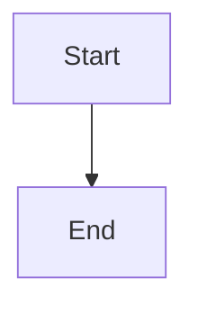

# Plan viewer comment chrome

## Parent Epic

epic_002

## Scope

GitHub-style line-level threads on /plan/{id}: source-map data-src-line, gutter or selection compose, re-anchor/outdated, blocking checkbox default off. Loads and posts via feat_016. No second markdown editor.

## Data structures

TBD.

## API contracts

TBD.

## Logic flow

## Task breakdown

_(empty — Feature Team mints tasks after dispatch)_

## Risks & upward questions

None.

## Decision log

None yet.
