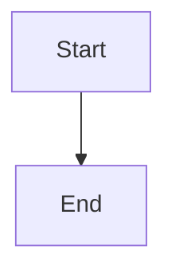

# Self-relaunching supervisor: launcher owns lock and listener, worker restarts on source change

## Parent Epic

epic_018

## Scope

## Intent

Split `cascade up` into a small long-lived **launcher** and a replaceable **worker**. The launcher acquires `.cascade/supervisor.lock`, binds the War Room listening socket once, and spawns the worker (`python -m cascade.workspace.worker`) with the socket fd inherited. When the worker detects a Cascade source change it exits with the update exit code (75); the launcher sweeps the worker's process group and spawns a fresh worker on the same socket. Clients queue in the socket backlog during the gap instead of getting connection refused.

## Acceptance

- Editing a `cascade/**/*.py` file while `cascade up` runs results in a new worker PID serving on the same host:port with no manual action; the launcher PID and lock holder are unchanged.
- A connection attempted during the restart gap succeeds (queued in backlog) rather than being refused.
- Worker runs in its own process group; after any worker exit, the launcher kills the group so no agent CLI subprocess survives its worker.
- Worker reports readiness to the launcher over an inherited pipe after the server is constructed and resume is scheduled.
- SIGINT/SIGTERM to the launcher forwards an operator stop to the worker, waits, and exits 0 without relaunching. Worker exit 0 = stop; 75 = update restart; other = crash (restarted; bounded backoff is owned by the failure-containment feature, a fixed 1s delay is fine here).
- The worker refuses to start without the launcher handshake (inherited fd + lock token env), preserving the single-supervisor invariant; `prepare_up` trunk validation still runs in the launcher before binding.
- One integration test: start `cascade up` in a subprocess against a temp workspace, touch a source file in a copied package, assert the listener stays connectable and a new worker PID answers.

## Out of scope

Draining in-flight work (feature 2), preflight/backoff/degraded mode/health UI (feature 3).

## Data structures

TBD.

## API contracts

TBD.

## Logic flow

## Task breakdown

_(empty — Feature Team mints tasks after dispatch)_

## Risks & upward questions

None.

## Decision log

None yet.
