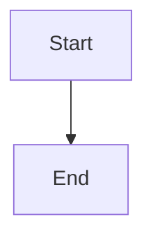

# Graceful worker drain: reject new writes as updating, finish in-flight requests and turns, recover the rest from checkpoints

## Parent Epic

epic_018

## Scope

## Intent

When the worker decides to exit for an update or operator stop, it enters **draining**: it stops starting new work, lets accepted work finish within a bound, cancels what is left safely, and leaves it to the existing checkpoint resume path (`resume_legally_active_graphs`) in the next worker. Because resume re-runs an interrupted role node from the start, every board tool must be replay-safe and every board write must survive a kill (epic dec_005, dec_007, dec_010).

## Builds on feat_018_001 (completed, verified against merged code; epic dec_012, dec_013)

001 did not ship a shutdown entry point. Shutdown is the inline `finally` block in `cascade/workspace/worker.py::run_worker`, and the exit code is inferred afterwards. This feature owns `run_worker`'s shutdown and exit codes, and stays out of `cascade/workspace/launcher.py` (feature 3 owns it):

- **Extract the shutdown function.** Pull the `finally` block into one function taking a reason: `update`, `stop`, or `launcher_lost`. The drain goes inside it for `update` and `stop`. Feature 3 runs its preflight in the source-change branch of `should_stop`, before a stop is reported; do not move or duplicate it.
- **Fix the fallback exit code.** `run_worker`'s trailing `return 0` (watchdog returned with neither flag set) makes the launcher treat it as an operator stop and exit, silently bringing the outage back. Return a non-zero crash code instead.
- **Detect launcher loss.** The worker runs in its own session and never holds the supervisor lock. If the launcher dies without forwarding a stop (SIGKILL, OOM kill, terminal hangup), the lock is released while the worker keeps running, and a fresh `cascade up` could resume the same graphs beside it. Record the launcher pid at start and treat a changed `os.getppid()` as launcher loss. Check it as the first line of `should_stop` and in every drain wait loop. With `launcher_lost`, skip the drain: close the server, SIGTERM agent pids, wait 5s, exit non-zero.
- **Idempotent SIGTERM handler.** Until feature 3 lands, the launcher re-sends SIGTERM every 0.2s while stopping; repeated signals must not restart or shorten the drain.
- The launcher already waits for the worker without a short timeout after forwarding a stop, so the drain needs no launcher change.
- Agents, MCP tool servers and git stay in the worker's process group; this feature must not introduce `setsid` / `start_new_session` / `process_group`.

Feature 3 also edits `run_worker` (the source-change branch of `should_stop`, and the readiness line). Whichever feature merges second rebases.

## Acceptance

### HTTP drain (epic dec_006)

- While draining, mutating HTTP requests (POST/PUT/PATCH/DELETE) get `503` with `Retry-After` and body `{"error":"updating"}`; GETs keep working until the join finishes.
- Every response while draining sets `Connection: close`, so idle keep-alive connections do not hold handler threads.
- Handler threads become tracked, non-daemon threads (bounded by `MAX_CONCURRENT_REQUESTS`) and are joined with a bound of the longest route deadline plus margin (about 65s). Handlers still running after that are logged and abandoned. An accepted write within its route deadline is never cut off mid-handler.

### Turn drain and cancellation (epic dec_007, dec_010)

- The watchdog stops dispatching new model turns and queue deliveries once draining begins.
- In-flight model turns get a bounded drain window (default 120s, `cascade.toml` override). At expiry the worker sends SIGTERM to each agent CLI **pid** (agents stay in the worker's process group, per dec_010), waits 5s, then exits with the shutdown reason's code (75 for `update`, 0 for `stop`). The launcher's `killpg` of the worker group (feature 1) covers anything left, including MCP tool-server grandchildren. HTTP join and turn drain run concurrently.
- Cancelled turns are resumed once by the next worker from durable checkpoints. Queued events that arrive during drain stay in their durable queues and are delivered by the next worker.
- On launcher loss, the worker stops serving and cancels its turns within about 10s, with no drain (dec_013).

### Replay-safe board effects (epic dec_005, dec_007)

- `record_decision`: an identical entry (same section and choice) already in the log returns the existing id and appends nothing.
- `mint_feature`: a child with the same title under the same parent returns the existing id; `append_event` fires only on actual creation.
- `reply_comment`: an identical body by the same author on the same comment returns the existing reply id.
- `resolve_amendment`: an already-resolved amendment is a no-op.
- `write_doc` keeps its `sha` compare-and-swap; `board/store.py` doc writes become atomic (temp file in the same directory, then `os.replace`).
- A resumed model choosing different wording is not deduplicated; that is accepted behavior.

### Integration tests (real `cascade up` subprocess, fake provider)

- (a) A write in flight when the update triggers is persisted and acknowledged; a write arriving during drain gets `503 updating`.
- (b) Replay contract: a fake-provider turn calls `record_decision` and `mint_feature`, outlives the drain window, is cancelled, and is resumed once after restart; the board shows exactly one decision and one feature.
- (c) A queued event during drain is delivered after restart.
- (d) Launcher loss: SIGKILL the launcher while a fake turn runs; the worker and the fake agent are gone within about 10s.
- No per-tool idempotency unit-test matrix and no unit test for the atomic write; test (b) covers both paths.

## Out of scope

Zero-downtime overlap of old and new workers. Per-tool-call checkpointing and a durable cross-worker effect journal (cut in epic). Stale `index.lock` sweep (feature 1). Preflight, backoff, status file, readiness placement and any edit to `launcher.py` (feature 3).

## Data structures

TBD.

## API contracts

TBD.

## Logic flow

## Task breakdown

_(empty — Feature Team mints tasks after dispatch)_

## Risks & upward questions

- The replay-safe tools and atomic writes are independent of the drain and can be the first task; they also fix duplicate effects after ordinary crashes.
- Feature 3 edits other lines of `run_worker` in parallel. Keep to the `finally` block, the exit codes, and the launcher-loss line at the top of `should_stop`.

## Decision log

None yet.
