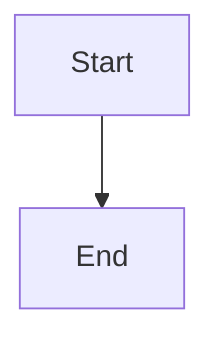

# Graceful worker drain: reject new writes as updating, finish in-flight requests and turns, recover the rest from checkpoints

## Parent Epic

epic_018

## Scope

## Intent

When the worker decides to exit for an update or operator stop, it enters **draining**: it stops starting new work, lets accepted work finish within a bound, and leaves anything unfinished to the existing checkpoint resume path (`resume_legally_active_graphs`) in the next worker.

## Acceptance

- While draining, mutating HTTP requests (POST/PUT/PATCH/DELETE) get `503` with `Retry-After` and body `{"error":"updating"}`; reads keep working until the server closes.
- HTTP handlers already accepted run to completion before the server closes (handler threads are tracked/joined; today `daemon_threads=True` lets shutdown abandon them). An accepted write is never cut off mid-handler.
- The watchdog stops dispatching new model turns and queue deliveries once draining begins.
- In-flight model turns get a bounded drain window (default 120s, `cascade.toml` override). Turns still running at the deadline are cancelled; their graphs are resumed exactly once by the next worker from durable checkpoints, with no duplicated board side effects (decision log entries, minted features, comments).
- Queued events that arrive during drain stay in their durable queues and are delivered by the next worker.
- Integration tests: (a) a write in flight when the update triggers is persisted and acknowledged; (b) a fake-provider turn longer than the drain window is cancelled and resumed once after restart with side effects applied once; (c) a queued event during drain is delivered after restart.

## Out of scope

Zero-downtime overlap of old and new workers.

## Data structures

TBD.

## API contracts

TBD.

## Logic flow

## Task breakdown

_(empty — Feature Team mints tasks after dispatch)_

## Risks & upward questions

None.

## Decision log

None yet.
