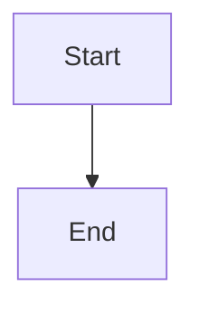

# Graceful worker drain: reject new writes as updating, finish in-flight requests and turns, recover the rest from checkpoints

## Parent Epic

epic_018

## Scope

## Intent

When the worker decides to exit for an update or operator stop, it enters **draining**: it stops starting new work, lets accepted work finish within a bound, cancels what is left safely, and leaves it to the existing checkpoint resume path (`resume_legally_active_graphs`) in the next worker. Because resume re-runs an interrupted role node from the start, every board tool must be replay-safe and every board write must survive a kill (epic dec_005, dec_007).

## Acceptance

### HTTP drain (epic dec_006)

- While draining, mutating HTTP requests (POST/PUT/PATCH/DELETE) get `503` with `Retry-After` and body `{"error":"updating"}`; GETs keep working until the join finishes.
- Every response while draining sets `Connection: close`, so idle keep-alive connections do not hold handler threads.
- Handler threads become tracked, non-daemon threads (bounded by `MAX_CONCURRENT_REQUESTS`) and are joined with a bound of the longest route deadline plus margin (about 65s). Handlers still running after that are logged and abandoned. An accepted write within its route deadline is never cut off mid-handler.

### Turn drain and cancellation (epic dec_007)

- The watchdog stops dispatching new model turns and queue deliveries once draining begins.
- In-flight model turns get a bounded drain window (default 120s, `cascade.toml` override). At expiry the worker sends SIGTERM to each agent's process group, waits 5s, then exits 75; the launcher's `killpg` (feature 1) covers anything left. HTTP join and turn drain run concurrently.
- Cancelled turns are resumed once by the next worker from durable checkpoints. Queued events that arrive during drain stay in their durable queues and are delivered by the next worker.

### Replay-safe board effects (epic dec_005, dec_007)

- `record_decision`: an identical entry (same section and choice) already in the log returns the existing id and appends nothing.
- `mint_feature`: a child with the same title under the same parent returns the existing id; `append_event` fires only on actual creation.
- `reply_comment`: an identical body by the same author on the same comment returns the existing reply id.
- `resolve_amendment`: an already-resolved amendment is a no-op.
- `write_doc` keeps its `sha` compare-and-swap; `board/store.py` doc writes become atomic (temp file in the same directory, then `os.replace`).
- A resumed model choosing different wording is not deduplicated; that is accepted behavior.

### Integration tests (real `cascade up` subprocess, fake provider)

- (a) A write in flight when the update triggers is persisted and acknowledged; a write arriving during drain gets `503 updating`.
- (b) Replay contract: a fake-provider turn calls `record_decision` and `mint_feature`, outlives the drain window, is cancelled, and is resumed once after restart; the board shows exactly one decision and one feature.
- (c) A queued event during drain is delivered after restart.
- No per-tool idempotency unit-test matrix and no unit test for the atomic write; test (b) covers both paths.

## Out of scope

Zero-downtime overlap of old and new workers. Per-tool-call checkpointing and a durable cross-worker effect journal (cut in epic). Stale `index.lock` sweep (feature 1).

## Data structures

TBD.

## API contracts

TBD.

## Logic flow

## Task breakdown

_(empty — Feature Team mints tasks after dispatch)_

## Risks & upward questions

- The replay-safe tools and atomic writes do not depend on feature 1's launcher. If feature 1 slips, the Feature Team may land them first as a standalone task; they also fix duplicate effects after ordinary crashes.

## Decision log

None yet.
