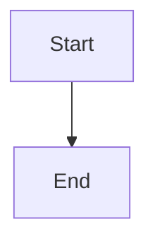

# Update failure containment: preflight, bounded backoff, degraded responder, and health status

## Parent Epic

epic_018

## Scope

## Intent

Make a bad update visible and survivable rather than silent downtime.

## Builds on feat_018_001 (completed, verified against merged code; epic dec_012, dec_013)

This feature is the only one that edits `cascade/workspace/launcher.py`. feat_018_002 owns the worker shutdown function in `cascade/workspace/worker.py`. Already shipped by 001 and usable as is: worker spawned as its own session with `start_new_session=True`, War Room serving on the inherited fd before resume, a fixed `CRASH_RESTART_DELAY_S` crash delay, and `sweep_stale_git_locks` called from `post_worker_exit` after every group kill.

001 did **not** ship these seams, so this feature adds them as part of its own work (do not reopen 001):

- **Launcher state-transition function.** Add one function that every launcher state change goes through. It logs one stderr line and writes `supervisor_status.json`. It replaces the ad hoc `print` calls.
- **Readiness means serving.** Move the single `_write_readiness` call in `run_worker` to just after the server thread starts, ahead of `resume_legally_active_graphs`. Backoff and the 60s reset key off it.
- **Stdlib-only fingerprint.** Move `_source_fingerprint` out of `cascade/workspace/up.py`, which imports Cascade modules, into a stdlib-only module. `up.py` re-exports it for the worker, and the launcher imports it once at start for the degraded responder.
- **Sweep returns data.** `sweep_stale_git_locks` returns the removed lock paths and any product-trunk lock path instead of `None`.
- **Forward once, escalate on a second signal.** While stopping, the launcher currently re-sends SIGTERM every 0.2s and never escalates. Forward the stop to the worker once. A second operator SIGINT/SIGTERM/SIGHUP must call `_kill_worker_group` at once. 002's drain can take about 190s, and without this escalation an operator's only option is to hard-kill the launcher, which leaves the worker's session holding the socket without the lock.
- **SIGHUP is an operator stop (dec_013).** The launcher handles only SIGINT and SIGTERM, so closing the terminal kills it with the default action and strands the worker. Handle SIGHUP exactly like SIGINT/SIGTERM in every launcher state.
- **Preflight placement.** There is no shutdown entry point to put the preflight in front of. Run it in the source-change branch of `run_worker`'s `should_stop`, before a stop is reported. Do not edit the shutdown `finally` block or the exit codes; 002 owns those. 002 also adds a launcher-loss check as the first line of `should_stop`; leave it there.

002 also edits `run_worker`, in different lines. Whichever feature merges second rebases.

## Acceptance

- **Preflight:** before draining for a source update, the running worker launches a short-lived subprocess that imports the Cascade entry modules from the new source and runs `prepare_up` (which validates only and does not take the supervisor lock). The preflight has a hard timeout of about 30s, because it blocks watchdog dispatch while it runs; a timeout counts as a failure. If it fails, the old worker keeps serving, status shows `update_blocked` with the error output, and it retries on the next fingerprint change (the failed fingerprint is remembered so it does not retry every second). Operator stop skips preflight.
- **Backoff:** if a new worker exits before reporting ready, the launcher retries with exponential backoff (1s doubling, capped at 30s, at most 5 consecutive attempts; the counter resets after a worker stays ready for 60s). This replaces the fixed 1s crash delay.
- **Degraded mode:** after attempts are exhausted the launcher stays alive holding the lock and socket, answers every request itself with `503` and a JSON/HTML diagnostic (last exit code, stderr tail, next action), and launches again automatically on the next source fingerprint change. SIGHUP is not a retry trigger; it stops the launcher like any operator signal. To retry without a source change, the operator stops and reruns `cascade up`.
- **Status:** the launcher writes `.cascade/supervisor_status.json` (`state` serving|draining|restarting|update_blocked|degraded, worker pid, restart count, last error, timestamps, and any product-trunk `.git/index.lock` warning from the sweep's returned data). `GET /api/health` returns it from both the worker and the degraded responder, and the War Room shows a banner whenever state is not `serving` or a trunk lock warning is present. Every transition is logged on stderr with one line.
- **Operator stop escalation:** a second operator signal while stopping kills the worker group immediately and the launcher exits.
- Integration tests: (a) a syntax error introduced into the source triggers `update_blocked` and the old worker keeps answering; (b) a worker that crashes on startup produces bounded retries, then degraded 503 with diagnostics; fixing the source recovers to `serving` without an operator. The seam changes above ride on these tests; no separate unit tests for them.

## Out of scope

HTTP and turn drain, the worker shutdown function and its exit codes, launcher-loss detection in the worker, replay-safe board tools and atomic writes (feature 2).

## Data structures

TBD.

## API contracts

TBD.

## Logic flow

## Task breakdown

_(empty — Feature Team mints tasks after dispatch)_

## Risks & upward questions

- feat_018_002 and this feature both edit `run_worker`. 002 owns the `finally` block, the exit codes and the launcher-loss line at the top of `should_stop`; this feature owns the source-change branch of `should_stop` and the readiness line.

## Decision log

None yet.
