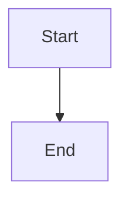

# Update failure containment: preflight, bounded backoff, degraded responder, and health status

## Parent Epic

epic_018

## Scope

## Intent

Make a bad update visible and survivable rather than silent downtime.

## Acceptance

- **Preflight:** before draining for a source update, the running worker launches a short-lived subprocess that imports the Cascade entry modules from the new source and runs `prepare_up`. If it fails, the old worker keeps serving, status shows `update_blocked` with the error output, and it retries on the next fingerprint change.
- **Backoff:** if a new worker exits before reporting ready, the launcher retries with exponential backoff (1s doubling, capped at 30s, at most 5 consecutive attempts; the counter resets after a worker stays ready for 60s).
- **Degraded mode:** after attempts are exhausted the launcher stays alive holding the lock and socket, answers every request itself with `503` and a JSON/HTML diagnostic (last exit code, stderr tail, next action), and launches again automatically on the next source fingerprint change or on SIGHUP.
- **Status:** the launcher writes `.cascade/supervisor_status.json` (`state` serving|draining|restarting|update_blocked|degraded, worker pid, restart count, last error, timestamps, and any product-trunk `.git/index.lock` warning from feature 1's sweep). `GET /api/health` returns it from both the worker and the degraded responder, and the War Room shows a banner whenever state is not `serving` or a trunk lock warning is present. Every transition is logged on stderr with one line.
- Integration tests: (a) a syntax error introduced into the source triggers `update_blocked` and the old worker keeps answering; (b) a worker that crashes on startup produces bounded retries, then degraded 503 with diagnostics; fixing the source recovers to `serving` without an operator.

## Data structures

TBD.

## API contracts

TBD.

## Logic flow

## Task breakdown

_(empty — Feature Team mints tasks after dispatch)_

## Risks & upward questions

None.

## Decision log

None yet.
