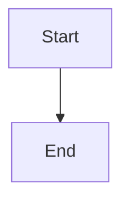

# Update failure containment: preflight, bounded backoff, degraded responder, and health status

## Parent Epic

epic_018

## Scope

## Intent

Make a bad update visible and survivable rather than silent downtime.

## Builds on feat_018_001 and feat_018_002 (both completed, verified against merged code; epic dec_012, dec_013, dec_014, dec_015)

This feature is the only one that edits `cascade/workspace/launcher.py`. Already shipped and usable as is: worker spawned as its own session with `start_new_session=True`, War Room serving on the inherited fd before resume, a fixed `CRASH_RESTART_DELAY_S` crash delay, `sweep_stale_git_locks` called from `post_worker_exit` after every group kill, and (from 002) `worker.drain_and_shutdown(server, server_thread, root=, reason="update"|"stop"|"crash", drain_seconds=)`, which drains HTTP and turns and cancels turns by SIGTERM to agent pids. Reason `crash` already skips the turn window.

001 did **not** ship these seams, so this feature adds them as part of its own work (do not reopen 001 or 002):

- **Launcher state-transition function.** Add one function that every launcher state change goes through. It logs one stderr line and writes `supervisor_status.json`. It replaces the ad hoc `print` calls.
- **Readiness means serving.** Move the single `_write_readiness` call in `run_worker` to just after the server thread starts, ahead of `resume_legally_active_graphs`. Backoff and the 60s reset key off it.
- **Stdlib-only fingerprint.** Move `_source_fingerprint` out of `cascade/workspace/up.py`, which imports Cascade modules, into a stdlib-only module. `up.py` re-exports it for the worker, and the launcher imports it once at start for the degraded responder.
- **Sweep returns data.** `sweep_stale_git_locks` returns the removed lock paths and any product-trunk lock path instead of `None`.
- **Forward once, escalate on a second signal.** While stopping, the launcher currently re-sends SIGTERM every 0.2s and never escalates. Forward the stop to the worker once. A second operator SIGINT/SIGTERM/SIGHUP must call `_kill_worker_group` at once. 002's drain can take about 190s, and without this escalation an operator's only option is to hard-kill the launcher, which leaves the worker's session running after the launcher is gone.
- **SIGHUP is an operator stop (dec_013).** The launcher handles only SIGINT and SIGTERM, so closing the terminal kills it with the default action and strands the worker. Handle SIGHUP exactly like SIGINT/SIGTERM in every launcher state.
- **Preflight placement.** Run it in the source-change branch of `run_worker`'s `should_stop`, **before** that branch calls `begin_drain()` and sets `shutdown_reason = "update"`. 002's merged code calls `begin_drain()` as soon as the fingerprint differs; if the preflight ran after it, a failed preflight would leave the old worker stuck answering every write with `503 updating`. Do not change `drain_and_shutdown` beyond what the launcher-loss item below needs.

002 did **not** ship launcher-loss detection (dec_013), so this feature now owns it (dec_014), together with the worker's share of the supervisor lock (dec_015):

- **Worker notices launcher loss.** Record `os.getppid()` at worker start. The first check in `should_stop` (ahead of the operator-stop check) treats a changed parent pid as launcher loss. Shutdown then runs through `drain_and_shutdown` with no turn window, the same way as reason `crash` (add a `launcher_lost` reason or reuse `crash`, whichever is less code), and the worker exits non-zero.
- **Worker shares the supervisor lock (dec_015).** `_spawn_worker` adds the `SupervisorLock` handle's fd to `pass_fds` and passes its number in the handshake (alongside or in place of the lock-path token). The worker keeps that fd open for its whole life. `flock` belongs to the open file description, so the lock stays held until both launcher and worker are gone, and a fresh `cascade up` refuses with "supervisor already running" while an orphaned worker winds down, whatever port it is given. The still-bound listening socket is **not** enough on its own: it only blocks a second `cascade up` on the same port. Keep subprocess's default `close_fds=True` everywhere under the worker so agents never inherit the lock. Change `SupervisorLock.release()` to only close its handle and never call `LOCK_UN`, because `LOCK_UN` on the shared description would drop the lock for a still-running worker too.

## Contract gaps closed before tasks are minted (epic dec_016)

- **Worker-side states have a writer.** `draining` and `update_blocked` are detected in the worker, not the launcher, so the launcher alone cannot report them. Put the status write in the same stdlib-only module as the fingerprint (temp file in `.cascade/`, then `os.replace`). The launcher's state-transition function writes `serving`, `restarting` and `degraded`; the worker writes `draining` and `update_blocked` through the same write function. Each write reads the current JSON and replaces only its own fields, so the restart count and the trunk-lock warning survive. No new worker-to-launcher channel.
- **One acceptor on the listening socket at a time.** The degraded responder serves on the launcher's listening fd. Before the launcher spawns the next worker it must stop accepting and finish any response in progress; otherwise launcher and worker race on `accept` and some requests get a stale degraded 503 from a recovered service. During backoff waits nobody accepts and connections wait in the kernel backlog, which is acceptable at the 30s cap.
- Both ride on integration tests (a) and (b) below (status shows `update_blocked`; recovery from degraded reaches `serving` and answers normally). No new tests.

## Sequencing within this feature (epic dec_016)

1. **First task: close the single-supervisor hole.** Launcher-loss check, shared lock fd, `release()` without `LOCK_UN`, SIGHUP as operator stop, forward-once and second-signal escalation, and integration test (c). This is a live invariant break on the epic branch today, it touches nothing the degraded mode needs, and it is mergeable on its own if the rest of the feature runs long.
2. Then the 001 seams (state-transition function with status write, readiness ahead of resume, stdlib fingerprint, sweep returns data).
3. Then preflight with test (a), then backoff, degraded responder, `/api/health` and banner with test (b).

## Acceptance

- **Preflight:** before draining for a source update, the running worker launches a short-lived subprocess that imports the Cascade entry modules from the new source and runs `prepare_up` (which validates only and does not take the supervisor lock). The preflight has a hard timeout of about 30s, because it blocks watchdog dispatch while it runs; a timeout counts as a failure. If it fails, the old worker keeps serving with writes still accepted (draining never began), status shows `update_blocked` with the error output, and it retries on the next fingerprint change (the failed fingerprint is remembered so it does not retry every second). Operator stop skips preflight.
- **Backoff:** if a new worker exits before reporting ready, the launcher retries with exponential backoff (1s doubling, capped at 30s, at most 5 consecutive attempts; the counter resets after a worker stays ready for 60s). This replaces the fixed 1s crash delay.
- **Degraded mode:** after attempts are exhausted the launcher stays alive holding the lock and socket, answers every request itself with `503` and a JSON/HTML diagnostic (last exit code, stderr tail, next action), and launches again automatically on the next source fingerprint change. SIGHUP is not a retry trigger; it stops the launcher like any operator signal. To retry without a source change, the operator stops and reruns `cascade up`.
- **Status:** `.cascade/supervisor_status.json` (`state` serving|draining|restarting|update_blocked|degraded, worker pid, restart count, last error, timestamps, and any product-trunk `.git/index.lock` warning from the sweep's returned data), written by launcher and worker as described above. `GET /api/health` returns it from both the worker and the degraded responder, and the War Room shows a banner whenever state is not `serving` or a trunk lock warning is present. Every transition is logged on stderr with one line.
- **Operator stop escalation:** a second operator signal while stopping kills the worker group immediately and the launcher exits.
- **Launcher loss:** if the launcher dies without forwarding a stop, the worker stops serving, cancels its turns and exits within about 10s, and holds the supervisor lock until it does.
- Integration tests: (a) a syntax error introduced into the source triggers `update_blocked`, the old worker keeps answering, and a POST still succeeds; (b) a worker that crashes on startup produces bounded retries, then degraded 503 with diagnostics; fixing the source recovers to `serving` without an operator; (c) `kill -9` on the launcher with a fake-provider turn live: immediately afterwards `cascade up --port <other>` on the same workspace exits non-zero, and after about 10s no worker or agent process is left. The seam changes above ride on these tests; no separate unit tests for them.

## Out of scope

HTTP and turn drain internals, replay-safe board tools and atomic writes (shipped by feature 2).

## Data structures

TBD.

## API contracts

TBD.

## Logic flow

## Task breakdown

_(empty — Feature Team mints tasks after dispatch)_

## Risks & upward questions

- `run_worker`'s trailing `return 0` (watchdog returned with neither stop nor update) is still in the merged code. It is unreachable today because `run_watchdog` only returns when `should_stop` is true, and `should_stop` only returns true for stop or update. If the launcher-loss check makes it reachable, it must return a non-zero code, never 0, or the launcher reads it as an operator stop and exits.

## Decision log

None yet.
