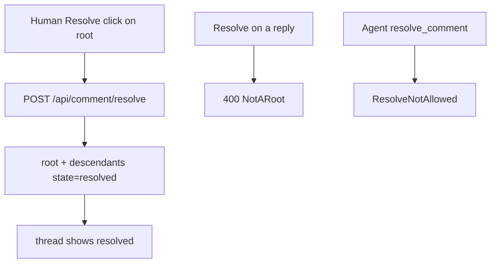

# Human resolve and audit

## Parent Epic

[epic_002](../../epics/2_active/epic_002_plan_view_review_threads.md) — Plan-view review threads.

Depends on: [feat_016](feat_016_comment_read_api_and_war_room_wiring.md), [feat_017](feat_017_plan_viewer_comment_chrome.md).

Cites (promote to frontmatter `cites:` when feat_019 lands): `epic_002#intent`, `epic_002#cross-module-constraints`.

Constraints this feature must honor:

- Blocking and resolve are human-only (epic constraint + dec_002). Agents may reply; they may not resolve or set blocking.
- Resolved threads stay in `docs/_comments/{doc_id}.jsonl`. Do not delete. Resolve rewrites `state` only.
- Resolve is **thread-level** (dec_009): only an open root may be resolved; the root and all descendants flip to `resolved`. Closeout blocks on any open human comment, so leaving replies open after resolving the root would still freeze complete.
- Completion rollup is unchanged: any **open human** thread still blocks epic/feature closeout (feat_008), whether or not it is blocking.
- No agent turn on resolve (dec_011). `CommentResolved` is ingested for the queue offset only.
- Localhost only. No new store.

## Scope

**In**

- Add POST `/api/comment/resolve` `{doc_id, comment_id}` with author forced to `human`. 404 if missing. 400 if `comment_id` is a reply (not a root). Already-resolved root is **idempotent 202** (double click is not an error).
- Change `cascade.comments.store.resolve_comment` to require `author="human"` and to cascade: given a root, rewrite that row and every row whose `parent` chain reaches it. Agent callers fail closed (`ResolveNotAllowed`). Reconstructing frozen `Comment` must copy feat_016 fields (`line_start`, `line_end`, `doc_sha`, `blocks`).
- Unregister `resolve_comment` from epic and feature planning tool registries (or keep the name and always raise). Agents keep `reply_comment`.
- Plan viewer: a **Resolve** control on each open root thread (human page, no auth beyond localhost). Calls the new route, then reloads threads. Resolved threads stay listed, visually quieter (feat_017 `.resolved`). No Resolve button on replies.
- Optional audit: when an agent turn locks a choice in response to a thread, `record_decision` body includes `In reply to: cmt_NNN` (DESIGN §10.4 already shows this). No new linkage table, no new sidecar field.

**Out**

- Letting agents resolve after they patch the doc (today's implicit path). Human must click Resolve. That is the human gate.
- Dispatch / mint / merge gates (feat_019). Resolving is what unblocks those gates.
- Agent review playbook (feat_020) beyond the one-line `In reply to:` convention above.
- Soft-delete, hide-resolved toggle, or GitHub-style "outdated and resolved" auto-collapse.
- A force-unresolve. Re-open is a new root comment.
- Kicking off a planning turn on resolve.

## Data structures

No new types. `Comment.state` remains `open | resolved`.

```text
ResolveNotAllowed   # store error when author != human
NotARoot            # store/HTTP error when comment_id has parent != null
```

## API contracts

```text
POST /api/comment/resolve
     {doc_id, comment_id}
     -> 202 {ok, comment_id}
     author is always human
     comment_id must be a root (parent is null)
     cascades state=resolved to root + descendants
     emits CommentResolved (already in store) once for the root
     does not call kickoff_graph_queue_event or kickoff_turn

resolve_comment(...)  # agent tool
     MUST fail for epic_manager / epic_architect / feature_lead / feature_architect
```

Existing `CommentResolved` queue event may still be ingested; feat_020 must not start a planning turn from it (dec_011).

## Logic flow



## Task breakdown

Feature Team mints after dispatch. Suggested slice:

1. **Store + tool guard** — `author=human` on resolve; cascade to descendants; agent tools denied; refuse non-roots. Store/API tests including a human reply that must not stay open after root resolve (closeout would still block).
2. **HTTP resolve + plan button** — POST route; Resolve control on feat_017 open roots only; idempotent 202. One plan-viewer + API test.

`In reply to:` is a playbook line, not a third implementation task.

## Risks & upward questions

- Today's agent tools can resolve. Shipping feat_017 before this feature leaves a window where the UI has no button and agents still can. Dispatch feat_018 next to feat_017, or the same wave.
- Not kicking off a turn on resolve avoids an agent immediately re-opening debate. If the operator wants a closeout note, they type a reply first.
- Cascade rewrites the sidecar (same as today's single-row rewrite). Do not append duplicate resolved rows.

## Decision log

- **D1 — Agents cannot resolve, even after a doc patch.** The human gate in Intent is a click, not a convention. Matches "Mark a thread resolved only as human."
- **D2 — No turn on resolve.** Resolve is a gate release, not a new question. feat_020 must skip `CommentResolved`.
- **D3 — Audit is `In reply to:` in the decision log.** DESIGN §10.4 already specifies it; a join table would be a second source of truth.
- **D4 — Resolve cascades through the thread (dec_009).** Closeout would otherwise stay blocked on the operator's own replies.
