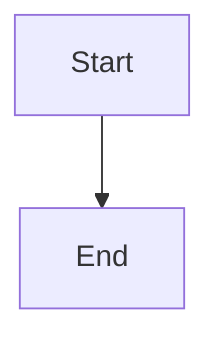

# Human resolve and audit

## Parent Epic

epic_002

## Scope

Human-only resolve: HTTP resolve on the existing comment routes, strip agent resolve tools, keep resolved rows in JSONL, resolve control on the plan thread list, optional record_decision In reply to: cmt_id.

## Data structures

TBD.

## API contracts

TBD.

## Logic flow

## Task breakdown

_(empty — Feature Team mints tasks after dispatch)_

## Risks & upward questions

None.

## Decision log

None yet.
