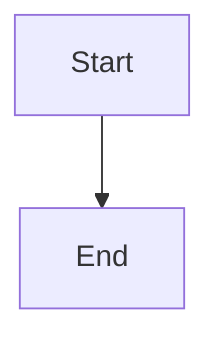

# Render anchored review threads inline

## Parent Epic

epic_019

## Scope

# Render anchored review threads inline

## Intent

Make persisted line-anchored review threads appear beside the epic or feature plan block they reference, including immediately after posting, while retaining a reliable bottom-tray fallback.

## Scope

- Route each root thread through the existing anchor-placement result.
- Insert placeable line-anchored thread nodes after their resolved `[data-src-line]` block.
- Keep whole-plan and unplaceable threads in the existing review tray.
- Preserve replies, resolve controls, state labels, outdated styling, reply drafts, polling refresh, and accessibility behavior in either location.
- Add only the CSS needed for inline layout and narrow viewports.
- Add focused regression coverage for initial load, post/refresh, same-block ordering, fallback placement, and no duplication.

## Out of scope

- Comment schema or sidecar migrations.
- API contract changes.
- Blocking-gate, agent-notification, or authorization changes.
- A new Markdown renderer or generalized annotation framework.
- Task-plan comments.

## Acceptance criteria

- Posting a line-anchored comment results in one thread beside the anchored rendered block without a page reload.
- Reloading or polling preserves that placement.
- Two or more threads on the same block render once each in stable API order.
- Replying to or resolving an inline thread updates it in place and retains any unrelated reply drafts.
- Global comments and anchors that cannot be safely placed render once in the bottom review tray.
- Outdated but relocatable threads remain inline and visibly marked outdated; unplaceable outdated threads use the tray fallback.
- Epic and feature plan pages pass focused UI tests; existing comment API and lifecycle tests remain green.

## Data structures

TBD.

## API contracts

TBD.

## Logic flow

## Task breakdown

_(empty — Feature Team mints tasks after dispatch)_

## Risks & upward questions

None.

## Decision log

None yet.
