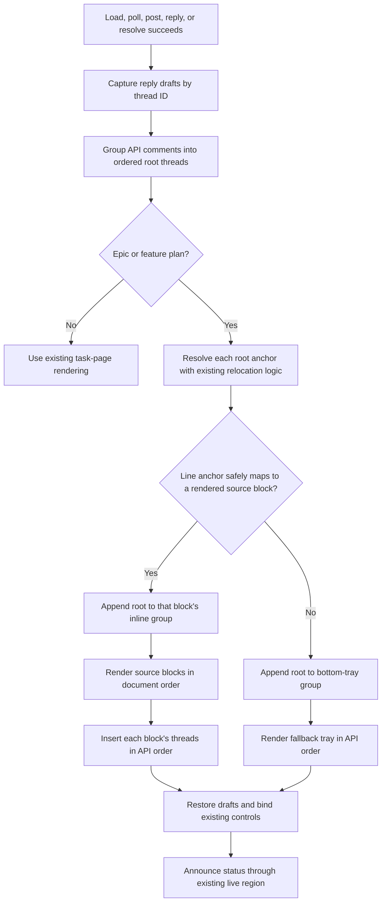

# Render anchored review threads inline

## Parent Epic

epic_019

## Intent

Make persisted line-anchored review threads appear beside the epic or feature plan block they reference, including immediately after posting, while retaining a reliable bottom-tray fallback.

## Scope

- Route each root thread through the existing anchor-placement result.
- Insert placeable line-anchored thread nodes after their resolved `[data-src-line]` block.
- Keep whole-plan and unplaceable threads in the existing review tray.
- Preserve replies, resolve controls, state labels, outdated styling, reply drafts, polling refresh, and accessibility behavior in either location.
- Add only the CSS needed for inline layout and narrow viewports.
- Add focused regression coverage for initial load, post/refresh, same-block ordering, fallback placement, and no duplication.

## Out of scope

- Comment schema or sidecar migrations.
- API contract changes.
- Blocking-gate, agent-notification, or authorization changes.
- A new Markdown renderer or generalized annotation framework.
- Task-plan comments.

## Acceptance criteria

- Posting a line-anchored comment results in one thread beside the anchored rendered block without a page reload.
- Reloading or polling preserves that placement.
- Two or more threads on the same block render once each in stable API order.
- Replying to or resolving an inline thread updates it in place and retains any unrelated reply drafts.
- Global comments and anchors that cannot be safely placed render once in the bottom review tray.
- Outdated but relocatable threads remain inline and visibly marked outdated; unplaceable outdated threads use the tray fallback.
- Epic and feature plan pages pass focused UI tests; existing comment API and lifecycle tests remain green.
- Inline controls remain keyboard reachable, status changes remain announced through the existing live region, and the layout does not force horizontal scrolling at supported narrow widths.

## Data structures

No persisted structures change. The client continues to consume the existing ordered comment collection, group replies under their root thread, and use each root's existing anchor metadata: document SHA, source-line range, anchor text, and current outdated/relocation result.

During one render pass, represent placement as an ephemeral partition:

- `inlineByBlock`: insertion-ordered groups keyed by the resolved rendered block (or its stable source-line identifier), with root threads retained in API order.
- `trayThreads`: whole-plan roots plus any line-anchored root for which placement cannot be resolved safely.
- `renderedThreadIds`: a render-local guard ensuring each root is emitted exactly once.

Replies remain owned by their root thread and are never placed independently. Preserve draft reply values by thread ID before replacing or moving rendered nodes, then restore them after reconciliation.

## API contracts

Use the existing contracts unchanged:

- `GET /api/comments/{doc_id}` supplies the ordered comments and anchor/lifecycle state used for grouping and placement.
- `POST /api/comment` creates roots and replies; on success, run the same refresh/reconciliation path used by polling so a new root moves directly to its inline or fallback destination.
- `POST /api/comment/resolve` changes resolution state; on success, reconcile the affected thread in its current destination without changing placement rules.

The UI must not infer successful mutations before the API response. Existing authorization, blocking semantics, error presentation, and assistive-technology announcements remain authoritative.

## Logic flow

Rendering is a single reconciliation pass: clear or reuse only managed thread containers, partition every root once, then populate inline groups and the tray. For several threads targeting one block, create one inline container immediately after that block and append threads in their incoming API order. Never repeatedly call `after()` on individual nodes in a way that reverses their order.

## Verification

Prefer focused, high-signal viewer tests over duplicating lower-level API coverage:

- Epic and feature initial load place resolvable roots inline.
- Successful post followed by refresh produces one inline root without reload.
- Polling and repeated renders do not duplicate or reorder threads.
- Multiple roots sharing a block retain API order.
- Whole-plan, invalid, missing, and unplaceable outdated anchors remain visible in the tray.
- Relocatable outdated anchors stay inline with the outdated indicator.
- Reply and resolve actions operate in place; unrelated draft replies survive reconciliation.
- Task pages retain their current layout.
- Keyboard focus, live-region updates, and narrow-viewport layout remain usable.

## Task breakdown

_(empty — Feature Team mints tasks after dispatch)_

## Risks & upward questions

- DOM insertion can reverse same-block order if each thread is inserted independently; mitigate with one per-block container populated in API order.
- Wholesale `innerHTML` replacement can lose reply drafts or focus; retain the existing draft-preservation path and reconcile managed containers only.
- Source metadata may resolve to nested rendered elements; use the existing canonical block-selection/relocation result rather than introducing a second matching algorithm.
- No upward question is blocking. Unresolved anchors deliberately fall back to the tray.

## Decision log

The feature inherits epic decisions `dec_001`–`dec_003`: client-only scope, visible tray fallback, and one end-to-end delivery slice.
