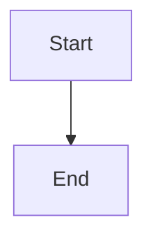

# Scoped dispatch gates

## Parent Epic

epic_002

## Scope

One gate blocking_threads_for(work_id) on human dispatch, Boss dispatch, mint_task, and merge. Scope per dec_003. cites: frontmatter + shared section_slug(). No bypass flag. Human-readable refusals.

## Data structures

TBD.

## API contracts

TBD.

## Logic flow

## Task breakdown

_(empty — Feature Team mints tasks after dispatch)_

## Risks & upward questions

None.

## Decision log

None yet.
