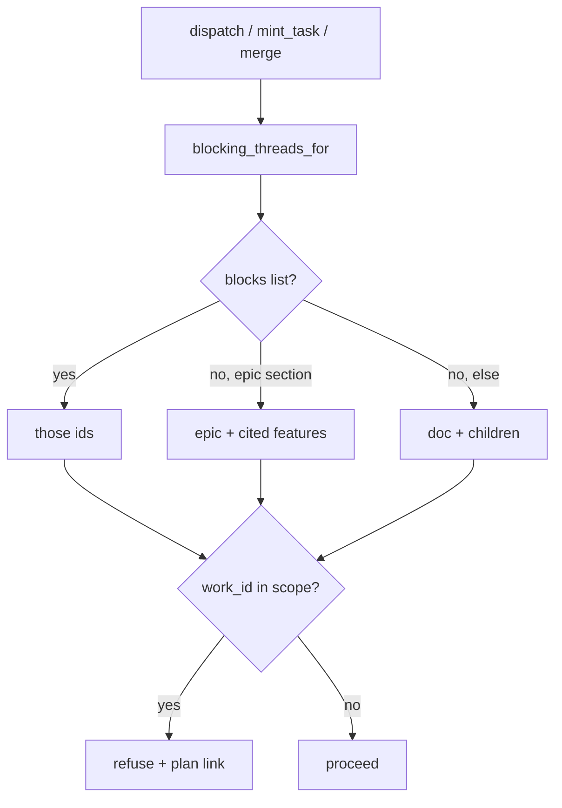

# Scoped dispatch gates

## Parent Epic

[epic_002](../../epics/2_active/epic_002_plan_view_review_threads.md) — Plan-view review threads.

Depends on: [feat_016](feat_016_comment_read_api_and_war_room_wiring.md) (`Comment.blocks`, `section`, `section_slug()`).

Cites (this feature adds the frontmatter field; until then record here): `epic_002#intent`, `epic_002#cross-module-constraints`, `epic_002#feature-breakdown`.

Constraints this feature must honor:

- Dispatch law unchanged: epic activate = human only; feature/task dispatch = human or Boss; agents cannot dispatch themselves.
- One gate, no bypass, no `force` flag (dec_004). Human unblocks by resolving (feat_018).
- Scope precedence locked (dec_003). Do not infer citations from spec prose.
- Completion rollup unchanged: any open human thread still blocks closeout, blocking or not.
- Slugs come from feat_016 `section_slug()`. Do not fork it.

## Scope

**In**

- Add `blocking_threads_for(work_id, *, root) -> GateResult` in one module (prefer `cascade/comments/gate.py` or `cascade/watchdog/` — one import site). Every path below calls it; a second checker is a defect.
- Call the gate from:
  - `dispatch_feature` / `dispatch_task` (human War Room and Boss),
  - `mint_task` (replaces today's "any open blocking comment on this feature"),
  - `merge_task_branch` / `merge_feature_branch`.
- Do **not** gate `mint_feature`, `activate_epic`, or `confirm_epic_complete`.
- Affected work for an **open blocking** root thread, in order:
  (a) `blocks` non-empty → exactly those work ids;
  (b) else section thread on an **epic** → that epic plus child features whose `cites` includes `{epic_id}#{section}`;
  (c) else section thread on a **feature**, or any thread with no line/section to bind (doc-level) → that doc and all its children.
  Tasks inherit from their parent feature. Replies never carry scope; only the root matters.
- Optional `cites: [str]` on **feature** frontmatter (`WorkMeta.cites`, default `[]`). Serde/parse must accept it and ignore unknown extra keys still. Epic Team / Feature Team fill it at mint/edit. Missing `cites` is a known limitation: that feature is not blocked by epic-section threads (dec_003).
- Refusal payload lists each thread's `id`, `doc_id`, `section`, and link `/plan/{doc_id}#plan-comments`. Cites that match no current heading on the cited doc are returned as `warnings` (do not fail closed on a stale cite).
- War Room / Boss dispatch responses already have a refusal string; put the list there. No new toast type required; reuse `blocked` if a toast already fires.

**Out**

- Inferring citations from markdown links or heading text.
- A human `force` / override flag.
- Gating `mint_feature` or epic activate.
- Changing closeout rules (still: any open human thread).
- Plan viewer chrome (feat_017) or resolve (feat_018).
- Rewriting historical comment `section` strings to slugs.

## Data structures

```text
WorkMeta.cites: [str]     # feature only; e.g. ["epic_002#cross-module-constraints"]
                          # empty on epic/task; default []

GateResult
  blocked: bool
  threads: [{id, doc_id, section, blocking}]
  warnings: [str]         # unmatched cites
```

## API contracts

```text
blocking_threads_for(work_id, *, root) -> GateResult
    only open + blocking roots count
    author may be human (only humans can set blocking today)

dispatch_feature / dispatch_task
    if gate.blocked: ok=false, reason lists threads + plan links

mint_task(feature_id, ...)
    if gate.blocked for that feature: FeatureToolDenied with the same text

merge_task_branch / merge_feature_branch
    if gate.blocked for the merged work (task inherits feature): refuse
```

## Logic flow



## Task breakdown

Feature Team mints after dispatch. Suggested slice:

1. **`cites` on WorkMeta** — optional list, default empty; parse/serde/round-trip. One board schema test.
2. **`blocking_threads_for`** — table-driven cases for (a)/(b)/(c), task inherit, unmatched-cite warning. This is the high-signal test; do not duplicate it per caller.
3. **Wire the four callers** — dispatch, mint_task, both merges. One API/system test per caller that the refusal text includes thread id and `/plan/` link.

## Risks & upward questions

- `cites` is a new `WorkMeta` field. Keep it optional so existing features keep parsing.
- A feature that forgets `cites` will not be gated by an epic-section thread. Accepted (dec_003). Do not add a linter in v1.
- Historical comments store free-text sections (`Open questions`). The gate compares slugs; those threads will not match `cites` until someone posts a new comment. Doc-level / `blocks` still work. Do not migrate old sidecars.
- Merge-gating a task because its parent feature is in scope may surprise operators. Same human gate as Intent; resolve the thread to merge.

## Decision log

- **D1 — `mint_feature` and `activate_epic` are not gated.** Smallest set that matches Intent (mint **tasks**, dispatch, merge). Blocking mint_feature would freeze planning itself.
- **D2 — One function, four callers.** Boss has no flag. Matches dec_004.
- **D3 — Unmatched cites warn, they do not block.** A renamed heading should not freeze the board; the operator still has `blocks:` and doc-level threads.
