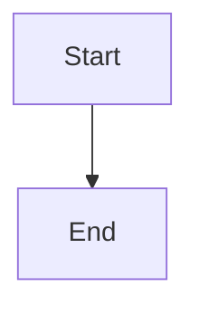

# Expose side-effect-free feature readiness and blockers

## Parent Epic

epic_020

## Intent

The War Room serializes `approved` for features but not why a backlog feature has not started. Add a read-only readiness view so the UI can show "Awaiting feature approval" and, after approval, the real remaining blocker.

## Scope

- Extract the gate checks in `cascade/watchdog/dispatch.py::_dispatch_feature` (open status/parent, `unmet_deps`, `not_approved`, dependency/epic `feature_awaiting_merge`, sibling block) plus the active-parent-epic check from `automation.reconcile_approval_dispatch` into one pure predicate module. `dispatch_feature` must call the same predicate, so the displayed reason and the actual dispatch decision cannot drift.
- The predicate must not call `ensure_feature_dispatch_selection`, write files, append events, or take the dispatch process lock.
- Serialize on feature rows in `cascade/war_room/serialize.py` (backlog/open features only): `readiness: {"approved": bool, "blockers": [codes]}`. Approval is reported independently of the other blockers, so an unapproved feature with unmet dependencies shows both.
- Codes are stable strings: `not_approved`, `unmet_deps` (with the dependency ids), `feature_awaiting_merge`, `sibling_blocked`, `dispatch_base_unavailable` (with the underlying reason), `review_threads_blocking`, `epic_inactive`.

### Architect constraints (verified against trunk)

- **Three call sites, not two.** Automatic dispatch today passes through three separate copies of the gates: `_dispatch_feature`, the feature filter in `cascade/boss/view.py::compute_boss_view` (which `reconcile_approval_dispatch` iterates over), and reconcile's active-parent check. The boss-view filter uses different checks (`feature_dependency_ready`, `feature_merge_gated`, `meta.approved_at`, and a `1_backlog` path check). All three must consume the shared predicate. Otherwise the board can show "no blockers" for a feature that reconcile never picks up.
- **No loosening.** Where the boss-view and dispatch checks differ, the predicate must be at least as strict as their conjunction today, so no path admits a feature it currently rejects. Record any semantic difference you find in this feature's decision log.
- **Post-gate refusals are blockers too.** `_dispatch_feature` can still refuse after the listed gates, through `ensure_feature_dispatch_selection` (`unsupported_topology`, `missing_predecessor_pr_identity`) and `comments.gate.refusal_if_blocked`. The predicate covers both read-only: use `read_feature_dispatch_selection`, or `plan_feature_dispatch` (pure) when no selection is persisted, never `ensure_*`. Then call `refusal_if_blocked`. The persisting `ensure_feature_dispatch_selection` call stays in `_dispatch_feature` after the predicate passes.
- **Dispatch results stay the same.** `_dispatch_feature` returns the first blocker in today's order and maps the new codes back to the existing `DispatchResult.reason` values: `sibling_blocked` becomes `feature_awaiting_merge`, `dispatch_base_unavailable` becomes its underlying reason, and `review_threads_blocking` becomes the existing refusal text. `epic_inactive` is reported for display and enforced by reconcile, but manual `dispatch_feature` keeps ignoring it as it does today.

## Out of scope

UI rendering (next feature), auto-approval, and any change to epic-plan snapshot semantics.

## Acceptance

- Existing dispatch, boss-view, and automation tests still pass unchanged (behavior-preserving refactor).
- One API-level test of `/api/board` (or the equivalent feature payload) covers an unapproved feature, an approved feature with an unmet dependency, and a ready feature. For the ready feature, it asserts that the board shows no blockers **and** that the feature appears in `compute_boss_view().dispatchable_features`, which proves there is no drift. Do not add unit tests per gate when the existing dispatch tests already exercise them.

## Data structures

TBD.

## API contracts

TBD.

## Logic flow

## Task breakdown

_(empty — Feature Team mints tasks after dispatch)_

## Risks & upward questions

None.

## Decision log

None yet.
