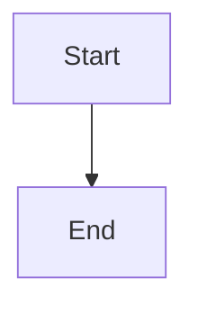

# Expose side-effect-free feature readiness and blockers

## Parent Epic

epic_020

## Intent

The War Room serializes `approved` for features but not why a backlog feature has not started. Add a read-only readiness view so the UI can show "Awaiting feature approval" and, after approval, the real remaining blocker.

## Scope

- Extract the gate checks in `cascade/watchdog/dispatch.py::_dispatch_feature` (open status/parent, `unmet_deps`, `not_approved`, dependency/epic `feature_awaiting_merge`, sibling block) plus the active-parent-epic check from `automation.reconcile_approval_dispatch` into one pure predicate module. `dispatch_feature` must call the same predicate, so the displayed reason and the actual dispatch decision cannot drift.
- The predicate must not call `ensure_feature_dispatch_selection`, write files, append events, or take the dispatch process lock.
- Serialize on feature rows in `cascade/war_room/serialize.py` (backlog/open features only): `readiness: {"approved": bool, "blockers": [codes]}`. Approval is reported independently of the other blockers, so an unapproved feature with unmet dependencies shows both.
- Codes are stable strings: `not_approved`, `unmet_deps` (with the dependency ids), `feature_awaiting_merge`, `sibling_blocked`, `epic_inactive`.

## Out of scope

UI rendering (next feature), auto-approval, and any change to epic-plan snapshot semantics.

## Acceptance

- Existing dispatch tests still pass unchanged (behavior-preserving refactor).
- One API-level test of `/api/board` (or the equivalent feature payload) covers an unapproved feature, an approved feature with an unmet dependency, and a ready feature. Do not add unit tests per gate when the existing dispatch tests already exercise them.

## Data structures

TBD.

## API contracts

TBD.

## Logic flow

## Task breakdown

_(empty — Feature Team mints tasks after dispatch)_

## Risks & upward questions

None.

## Decision log

None yet.
