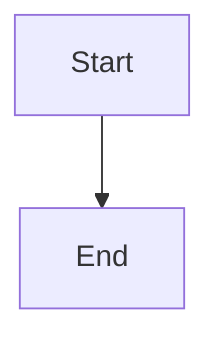

# War Room feature approval control with end-to-end late-mint test

## Parent Epic

epic_020

## Scope

## Intent

Give operators a visible, human-only way to approve a feature that was minted after its epic plan was approved, and prove the full path works end to end.

## Scope

- `cascade/war_room/static/war_room.js` feature rows: when `readiness.approved` is false, show an "Awaiting feature approval" status and an "Approve feature" button that POSTs `/api/approve_feature` with `{id}`. Reuse the existing `actionButton`/`dispatch` helpers and the epic "Approve plan"/"Approved" pattern.
- Feedback: disable the button and show a pending state while the request is in flight. On success, show a confirmation and refresh the board. On a 409 or network error, surface the server message in the existing toast/error area and re-enable the button.
- Once approved, render the remaining `readiness.blockers` as human-readable text (dependency ids, awaiting merge/review, sibling, epic inactive). When there are no blockers, render nothing extra; the feature moves to active through normal reconciliation.
- Backend: no new endpoint or store. Only touch `approvals.py` or the handler if the integration test exposes a real defect.

## Acceptance (one integration test, browser-level or HTTP + rendered-board level)

1. An epic with initial children has its plan approved, and those children are approved.
2. A feature minted afterward is not approved and shows the awaiting-approval state and the action.
3. One approval POST returns 200 without running a model turn inline (stub the kickoff runner and assert it is queued in the background, not invoked on the request thread).
4. Exactly one `dispatch_feature` succeeds. A second approve POST and a board refresh produce no extra dispatch, worktree, queue event, or kickoff.
5. Variant: if the late feature depends on an unmerged sibling, approval persists, the feature stays in backlog, and the blocker is shown.

## Data structures

TBD.

## API contracts

TBD.

## Logic flow

## Task breakdown

_(empty — Feature Team mints tasks after dispatch)_

## Risks & upward questions

None.

## Decision log

None yet.
