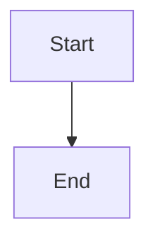

# War Room feature approval control with end-to-end late-mint test

## Parent Epic

epic_020

## Intent

Give operators a visible, human-only way to approve a feature that was minted after its epic plan was approved, and prove the full path works end to end.

## Scope

- `cascade/war_room/static/war_room.js` feature rows: when `readiness.approved` is false, show an "Awaiting feature approval" status and an "Approve feature" button that POSTs `/api/approve_feature` with `{id}`. Reuse the existing `actionButton`/`dispatch` helpers and the epic "Approve plan"/"Approved" pattern.
- Feedback: disable the button and show a pending state while the request is in flight. On success, show a confirmation and refresh the board. On a 409 or network error, surface the server message in the existing toast/error area and re-enable the button.
- Once approved, render the remaining `readiness.blockers` as human-readable text: dependency ids, awaiting merge/review, sibling, stacked base unavailable (with reason), blocking review threads, and epic inactive. Unknown codes render verbatim rather than being hidden. When there are no blockers, render nothing extra; the feature moves to active through normal reconciliation.
- Backend: no new endpoint or store. Only touch `approvals.py` or the handler if the integration test exposes a real defect.

### Readiness contract as merged by feat_020_001 (Architect, verified on `epic/epic_020`)

Source: `cascade/feature/readiness.py::compute_feature_readiness`, serialized by `cascade/war_room/serialize.py::feature_readiness_to_dict`. Build against this, not against the earlier prose.

- `readiness` is present **only** on feature rows that are open (`backlog`/`ready_to_plan`) and in `1_backlog`. Absent `readiness` means "not a backlog row": render no approval control and no blocker text.
- `readiness.approved` is the sole input for the approval control. `not_approved` also appears in `blockers`, but do not render it twice; the "Awaiting feature approval" status covers it.
- Blockers are flat strings, and two carry a payload after a colon. Match on the prefix before the first `:`:
  - `unmet_deps:<id>,<id>` gives sorted, comma-joined dependency ids.
  - `dispatch_base_unavailable:<reason>` gives the underlying reason (e.g. `unsupported_topology`, `missing_predecessor_pr_identity`).
  - Bare codes: `not_approved`, `feature_awaiting_merge`, `sibling_blocked`, `review_threads_blocking`, `epic_inactive`, `not_in_backlog`.
- A parentless feature returns only `["epic_inactive"]` (no `not_approved` entry even when unapproved). The control still keys on `approved`.
- The board computes readiness on every refresh. Do not add client-side gate logic; the row only renders what the server sends.

## Acceptance (one integration test, browser-level or HTTP + rendered-board level)

1. An epic with initial children has its plan approved, and those children are approved.
2. A feature minted afterward is not approved and shows the awaiting-approval state and the action.
3. One approval POST returns 200 without running a model turn inline (stub the kickoff runner and assert it is queued in the background, not invoked on the request thread).
4. Exactly one `dispatch_feature` succeeds. A second approve POST and a board refresh produce no extra dispatch, worktree, queue event, or kickoff.
5. Variant: if the late feature depends on an unmerged sibling, approval persists, the feature stays in backlog, and the blocker is shown. Assert on the `unmet_deps:<sibling_id>` prefix form, plus `feature_awaiting_merge` / `sibling_blocked` if the fixture puts the sibling in review.

Reuse the fixtures in `tests/war_room/test_board_feature_readiness.py` where they fit rather than building a parallel fixture set.

## Data structures

TBD.

## API contracts

TBD.

## Logic flow

## Task breakdown

_(empty — Feature Team mints tasks after dispatch)_

## Risks & upward questions

None.

## Decision log

None yet.
