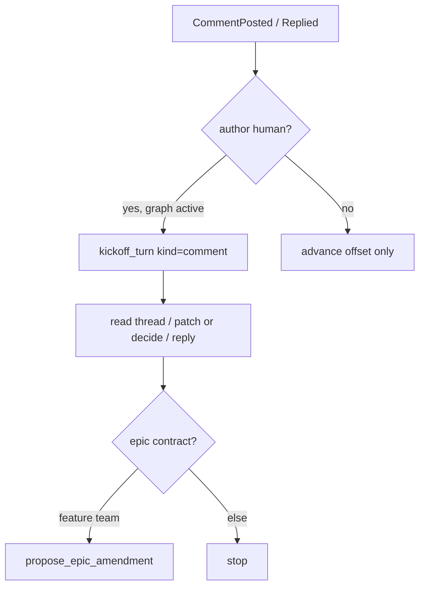

# Agent review turns

## Parent Epic

[epic_002](../../epics/2_active/epic_002_plan_view_review_threads.md) — Plan-view review threads.

Depends on: [feat_016](feat_016_comment_read_api_and_war_room_wiring.md).

Cites (promote to frontmatter `cites:` when feat_019 lands): `epic_002#macro-architecture`, `epic_002#intent`.

Constraints this feature must honor:

- Kickoff edges only (feat_014). A model turn starts on an authorized edge, not on a watchdog poll with no new event.
- Owning graph only: epic-tier `doc_id` → `epic_{id}`; feature-tier → `feat_{id}`. Tasks have no comment room.
- Agents reply and may `write_doc` / `record_decision` / `propose_epic_amendment`. They do not resolve (feat_018) and do not set blocking.
- No timer polling for new comments.

## Scope

**In**

- When a **human** `CommentPosted` or `CommentReplied` is ingested for an active owning graph, start **one** planning turn via existing `kickoff_turn(kind="comment")`, staging the comment body (id, section, blocking, snippet) as the turn input. This must work even when the graph has no prior chat messages. Today's `kickoff_graph_queue_event` → `kind=queue_event` path no-ops without `latest_input`; that is the bug this feature fixes.
- Agent-authored `CommentReplied` / `CommentPosted` must **not** request another comment-kind turn. Ingest the queue offset so it is not re-delivered, then stop. A reply loop is a defect.
- War Room POST `/api/comment` already calls `kickoff_graph_queue_event`. Point that call (or a sibling) at the same human-comment kickoff helper so HTTP and watchdog share one function.
- Playbook (short addition to existing epic/feature role skills, not a new skill file):
  1. Read the thread (`read_doc` + comments).
  2. Answer, patch the owning spec, or `record_decision` (include `In reply to: cmt_NNN` when locking a choice).
  3. `reply_comment` with what changed or why not.
  4. If a **feature** turn needs an epic contract change: `propose_epic_amendment`, do not silently edit the epic.
  5. Never `resolve_comment`.
- One system test: human comment on an activated epic with empty chat → exactly one kickoff. Agent reply in that thread → no second kickoff.

**Out**

- New queue event types.
- Polling `/api/comments` from the watchdog.
- Auto-resolve after a patch.
- Plan viewer chrome, HTTP schema, or dispatch gates (feat_016–019).
- A new role or a dedicated "reviewer" graph.

## Data structures

```text
KickoffReason.kind == "comment"   # already exists
  work_id: owning graph id
  by: human | watchdog
  message: "cmt_NNN on {doc_id} #{section} [blocking]\n{body}"
```

No new persistence.

## API contracts

```text
kickoff_human_comment(doc_id, comment_id, *, root) -> bool
    no-op if author != human
    no-op if owning graph is not 2_active
    otherwise kickoff_turn(kind="comment", message=...)
    shared by HTTP POST and deliver_queue_kickoffs

CommentPosted / CommentReplied queue payloads stay as they are
    (doc_id, comment_id, author, section?)
```

## Logic flow



## Task breakdown

Feature Team mints after dispatch. Suggested slice:

1. **Shared human-comment kickoff** — one helper; HTTP + watchdog; skip agent authors. The empty-chat vs agent-reply system test is the acceptance test.
2. **Playbook blurb** — add the five bullets to the existing epic/feature role skills. No new skill path.

## Risks & upward questions

- Double kickoff: HTTP already calls `kickoff_graph_queue_event`, and the watchdog later sees the same event. The helper must be idempotent per `comment_id` (or the HTTP path must only enqueue and let the watchdog deliver). Prefer **watchdog-only delivery** plus HTTP enqueue, so there is one edge. If HTTP keeps an eager kickoff, it must use the same helper and the watchdog must not fire a second turn for that offset.
- Staging the full comment body into the turn can be long. Cap the staged message (e.g. 2k chars) and tell the agent to `read` the sidecar for the rest.
- A human reply on an already-busy graph should still get one turn, not be dropped on `resume_inflight`.

## Decision log

- **D1 — Human comments use `kind=comment`, not `queue_event`.** `queue_event` requires prior chat input and misses the first review on a quiet graph.
- **D2 — Agent replies never kickoff.** Prevents a reply loop; the human comes back if they want another round.
- **D3 — No new skill file.** Five bullets on existing role skills are enough; a new reviewer role would not serve the core problem.
