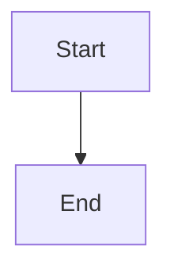

# Agent review turns

## Parent Epic

epic_002

## Scope

One planning turn per human CommentPosted/CommentReplied on the owning graph. Do not loop on agent replies. Playbook: interpret, patch or decide, reply, amend if the epic contract changes. Agents never resolve.

## Data structures

TBD.

## API contracts

TBD.

## Logic flow

## Task breakdown

_(empty — Feature Team mints tasks after dispatch)_

## Risks & upward questions

None.

## Decision log

None yet.
