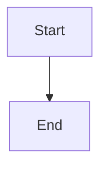

# Supervisor health observation and bounded remediation

## Parent Epic

epic_022

## Scope

## Objective

Integrate periodic direct-report health inspection into the existing supervisor lifecycle and make one bounded, role-authorized recovery attempt per unchanged child incident.

## Required outcomes

- Use the canonical work hierarchy and persisted status model.
- Classify reports into no-action, remediation-eligible, or unresolved outcomes using existing status names and transition rules.
- Exclude terminal reports and supervisors.
- Make cadence configurable through the existing runtime configuration pattern.
- Prevent duplicate recovery actions across repeated or concurrent sweeps by keying attempts to child identity and observed state/version.
- Resolve the epic’s implementation-discovery questions about canonical states, legal transitions, and safe recovery primitives before coding mutations.

## Acceptance coverage

Integration tests demonstrate healthy no-op behavior, one eligible recovery attempt, successful recovery, terminal exclusion, repeat-sweep idempotency, and transient failure handling.

## Non-goals

No new scheduler, state taxonomy, dashboards, notification integrations, or unlimited retries.

## Data structures

TBD.

## API contracts

TBD.

## Logic flow

## Task breakdown

_(empty — Feature Team mints tasks after dispatch)_

## Risks & upward questions

None.

## Decision log

None yet.
