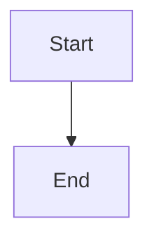

# Unresolved blockage propagation and reconciliation

## Parent Epic

epic_022

## Scope

## Objective

Propagate an unresolved direct-report blockage into the supervisor’s canonical blocked/stuck state, then safely remove only that monitoring-derived cause after recovery.

## Required outcomes

- Persist machine-readable provenance containing the originating direct-report ID and concise reason.
- Reuse canonical state transitions and optimistic/version checks; never write status storage directly.
- Apply the same direct-report rule at feature and epic levels so task blockage can propagate through the hierarchy.
- Treat already-applied concurrent transitions as success and never mutate or resurrect terminal work.
- On later sweeps, reconcile only monitoring-derived causes whose child condition has cleared; preserve unrelated manual and sibling blockers.

## Acceptance coverage

Integration tests demonstrate unresolved child propagation, task → feature → epic visibility, concurrent/manual-state safety, recovery clearing, and preservation of unrelated blocker causes.

## Non-goals

No new incident subsystem, dashboard, paging integration, recursive hierarchy scan, or automated resolution of decisions requiring human authority.

## Data structures

TBD.

## API contracts

TBD.

## Logic flow

## Task breakdown

_(empty — Feature Team mints tasks after dispatch)_

## Risks & upward questions

None.

## Decision log

None yet.
