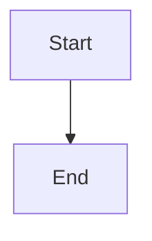

# Centered responsive War Room layout and resizable panels

## Parent Epic

epic_023

## Scope

Deliver the epic's layout success criteria: context left, board center, utilities right on wide screens; stable board width across polls; full viewport use; clamped panel resizing saved in this browser with reset; usable narrow layouts and keyboard-accessible controls. Preserve existing board actions, lens, chat, and sidebar behavior.

## Data structures

TBD.

## API contracts

TBD.

## Logic flow

## Task breakdown

_(empty — Feature Team mints tasks after dispatch)_

## Risks & upward questions

None.

## Decision log

None yet.
