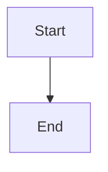

# Durable backlog feature priority

## Parent Epic

epic_023

## Scope

Deliver the epic's per-epic backlog feature ordering contract. Persist a canonical shared order; expose a guarded reorder command with stale and membership validation; project order into the board; support drag/drop and focused up/down controls. Verify reload, second-client visibility, creation/removal, and concurrent-write refusal without changing dispatch eligibility.

## Data structures

TBD.

## API contracts

TBD.

## Logic flow

## Task breakdown

_(empty — Feature Team mints tasks after dispatch)_

## Risks & upward questions

None.

## Decision log

None yet.
