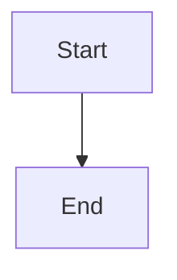

# War Room latency review and targeted fixes

## Parent Epic

epic_023

## Scope

Measure a reproducible local baseline for navigation-to-usable-board, board API time, render cost, and action feedback; fix measured bottlenecks; publish before/after timings on the same fixture. Meet the epic's p95 under-2-second initial usable-board target across at least 20 runs after the layout and priority features land, preserving lifecycle freshness and current errors.

## Data structures

TBD.

## API contracts

TBD.

## Logic flow

## Task breakdown

_(empty — Feature Team mints tasks after dispatch)_

## Risks & upward questions

None.

## Decision log

None yet.
