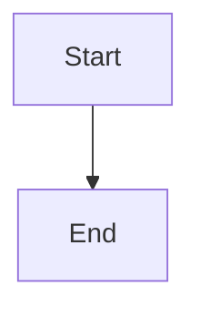

# Durable action recovery state

## Parent Epic

epic_026

## Scope

## Objective

Persist one recoverable lifecycle action across retries and supervisor restarts.

## Scope

- Stable action identity and recovery state.
- Failure classification: deterministic repair, transient retry, owner decision, human gate, terminal blocker.
- Serialized execution, bounded attempts, idempotent resume, and attempt history.

## Acceptance

Restart and concurrent-retry integration tests prove one logical action creates no duplicate team turns, reviews, merges, or completion events.

## Out of scope

Recovery implementations, War Room presentation, and generic workflow orchestration.

## Data structures

TBD.

## API contracts

TBD.

## Logic flow

## Task breakdown

_(empty — Feature Team mints tasks after dispatch)_

## Risks & upward questions

None.

## Decision log

None yet.
