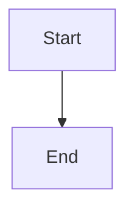

# Supervisor repair and owning-team handoff

## Parent Epic

epic_026

## Scope

## Objective

Repair deterministic lifecycle failures within the supervisor boundary and hand semantic decisions to the correct owning team.

## Scope

- Resume an interrupted Task run.
- Restore a missing integration checkout.
- Retry a queued merge after mechanical preconditions recover.
- Route semantic task/code conflicts to the Feature Team.
- Route cross-feature or epic-contract conflicts to the Epic Team.
- Resume the same persisted action after a recorded resolution.

## Acceptance

Interrupted Task and feature merge-conflict scenarios either resume to completion or enter the correct owned decision state without widening Task worker permissions.

## Out of scope

Automatic semantic conflict resolution and new worker Git or forge permissions.

## Data structures

TBD.

## API contracts

TBD.

## Logic flow

## Task breakdown

_(empty — Feature Team mints tasks after dispatch)_

## Risks & upward questions

None.

## Decision log

None yet.
