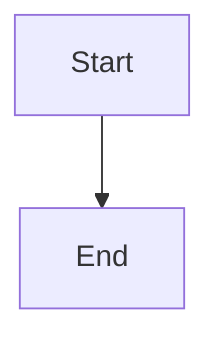

# War Room recovery feedback and retry

## Parent Epic

epic_026

## Scope

## Objective

Expose recovery progress and one safe retry path on the original War Room action.

## Scope

- Show recovery phase, typed reason, attempt count, owner, affected checkout or branch, and next safe step.
- Provide one retry control for retryable terminal blockers.
- Keep human approval and review gates distinct from retry.

## Acceptance

Transient forge failure, permission refusal, and concurrent retry scenarios show the correct state and produce at most one resumed execution.

## Out of scope

A second orchestration path or bypasses for approval, review, credentials, or permissions.

## Data structures

TBD.

## API contracts

TBD.

## Logic flow

## Task breakdown

_(empty — Feature Team mints tasks after dispatch)_

## Risks & upward questions

None.

## Decision log

None yet.
