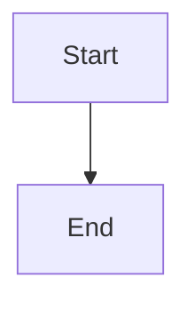

# Dirty-trunk-safe epic close

## Parent Epic

epic_026

## Scope

## Objective

Complete epic close without touching unrelated changes in the operator's product trunk checkout.

## Scope

- Use an isolated checkout based on verified remote product trunk for trunk-dependent closeout work.
- Reuse or open the normal closeout review.
- Verify the implementation review is merged and terminal closeout review is satisfied.
- Resume the original persisted close action.

## Acceptance

An epic closes while operator trunk contains unrelated tracked and untracked files; those files and the operator checkout remain byte-for-byte and index-state unchanged.

## Out of scope

Stashing, cleaning, resetting, committing, or merging operator changes.

## Data structures

TBD.

## API contracts

TBD.

## Logic flow

## Task breakdown

_(empty — Feature Team mints tasks after dispatch)_

## Risks & upward questions

None.

## Decision log

None yet.
