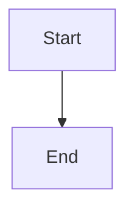

# Enforce the durable Task delivery boundary

## Parent Epic

epic_027

## Scope

Implement the epic's commit-first final-validation contract: record Task ID, deliverable SHA, and Feature-base SHA; durably queue the matching merge before setting awaiting_merge or emitting ready. Revalidate on commit/base change and make replay idempotent. Include integration coverage for drains after commit and validation, red validation, changed evidence, and duplicate-queue prevention.

## Data structures

TBD.

## API contracts

TBD.

## Logic flow

## Task breakdown

_(empty — Feature Team mints tasks after dispatch)_

## Risks & upward questions

None.

## Decision log

None yet.
