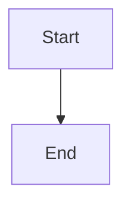

# Detect and recover orphaned Task delivery

## Parent Epic

epic_027

## Scope

Extend the direct-report health sweep and a shared supervisor recovery operation. Under the Task lifecycle lock, derive a stable incident, recheck ownership and durable delivery evidence, then requeue a matching validated commit or resume the existing branch, worktree, checkpoint, and pinned execution inputs. Preserve dirty state. Cover restart replay, live-owner protection, bounded cancellation, unsafe or missing Git state, drains before commit or queue, and concurrent requests.

## Data structures

TBD.

## API contracts

TBD.

## Logic flow

## Task breakdown

_(empty — Feature Team mints tasks after dispatch)_

## Risks & upward questions

None.

## Decision log

None yet.
