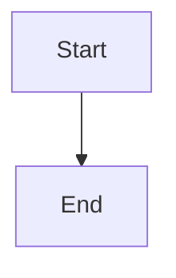

# Prepare and reconcile epic closure through one implementation review

## Parent Epic

epic_028

## Scope

Implement the single-review epic lifecycle: stage the epic plan's completed-state move on the implementation branch before opening the review; keep closure pending while it is open; after merge, verify both the merged review and completed epic document on remote trunk; finalize without creating a terminal-only closeout PR. Preserve the human review policy and leave the operator product-trunk checkout untouched. Add high-signal coverage for idempotent preparation, verification blockers, reconciliation, and absence of a second PR.

## Data structures

TBD.

## API contracts

TBD.

## Logic flow

## Task breakdown

_(empty — Feature Team mints tasks after dispatch)_

## Risks & upward questions

None.

## Decision log

None yet.
