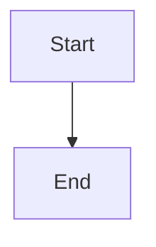

# Persist and expose epic implementation-review state

## Parent Epic

epic_028

## Scope

Extend the close result, durable forge review snapshot/lookup, and board/API serialization with an explicit epic close stage, validated review URL, source and target branches, forge state, and actionable blocker details. Reconstruct pending state after restart and make repeated Close requests return the existing review rather than create another. Cover pending, refresh/restart reconstruction, failed or missing lookup, and idempotency.

## Data structures

TBD.

## API contracts

TBD.

## Logic flow

## Task breakdown

_(empty — Feature Team mints tasks after dispatch)_

## Risks & upward questions

None.

## Decision log

None yet.
