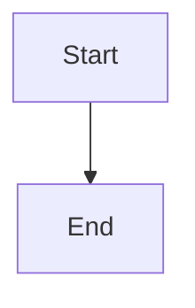

# Show durable epic close-review controls in the War Room

## Parent Epic

epic_028

## Scope

Render the persisted epic close stage beside the Epic row's Close action. Show a safe external `Open implementation review` link while pending, retain it across refresh/navigation/restart, expose `Finish close` when automatic reconciliation cannot run, and replace ambiguous status with actionable blockers. Reuse the existing safe external-link component and avoid rendering forge text as HTML. Add browser coverage for link accessibility, refresh, pending and blocker states, and completion.

## Data structures

TBD.

## API contracts

TBD.

## Logic flow

## Task breakdown

_(empty — Feature Team mints tasks after dispatch)_

## Risks & upward questions

None.

## Decision log

None yet.
