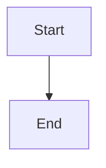

# Provider preflight and durable blocker state

## Parent Epic

epic_029

## Scope

Add the shared provider/model/tier capability check at Epic activation and Feature/Task dispatch, recheck at the execution boundary, classify deterministic versus transient setup failures, and persist one safe restart-visible provider-blocked incident per work item. Do not create worktrees/checkpoints on failed preflight or affect unrelated work.

## Data structures

TBD.

## API contracts

TBD.

## Logic flow

## Task breakdown

_(empty — Feature Team mints tasks after dispatch)_

## Risks & upward questions

None.

## Decision log

None yet.
