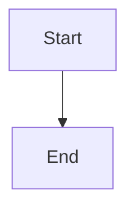

# Eligibility contract and operator control

## Parent Epic

epic_030

## Scope

Deliver the shared fail-closed return-eligibility evaluator, stable refusal reason codes, human authorization, API contract, and War Room Epic-row control. Both presentation and command enforcement must consume the same evaluator. Cover every predicate with table-driven tests and prove failed startup attempts without substantive mutation remain eligible.

## Data structures

TBD.

## API contracts

TBD.

## Logic flow

## Task breakdown

_(empty — Feature Team mints tasks after dispatch)_

## Risks & upward questions

None.

## Decision log

None yet.
