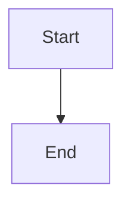

# Durable idempotent active-to-backlog transition

## Parent Epic

epic_030

## Scope

Deliver turn quiescence, per-Epic lifecycle locking and locked eligibility recheck, a durable replay-safe transition journal, active-run artifact preservation, source-brief restoration, active-pointer removal, stale-run invalidation, recovery, and deduplicated audit emission. Verify concurrent/repeated requests, restart at each durable boundary, racing turns, Git safety refusals, and no operator-trunk mutation.

## Data structures

TBD.

## API contracts

TBD.

## Logic flow

## Task breakdown

_(empty — Feature Team mints tasks after dispatch)_

## Risks & upward questions

None.

## Decision log

None yet.
