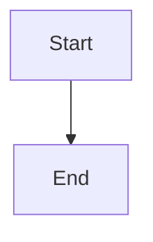

# Durable branch-action recovery and owning-team handoff

## Parent Epic

epic_031

## Scope

## Outcome

Route the first unsuccessful branch or lifecycle action through one durable recovery boundary, preserve its identity and evidence, and queue exactly one investigation for the owning Feature or Epic Team.

## Scope

- Extend the existing epic_026 recovery record and normal team queues.
- Cover operator and supervisor branch updates, Task-to-Feature, Feature-to-Epic, and Epic promotion/close merges.
- Provide bounded supervisor repair and a command to resume the same action under the lifecycle lock.
- Persist state transitions and precise human blockers across restart.

## Acceptance focus

The first failure is durable and routed once; retries are idempotent; safe repair can resume the original action; user files, approvals, and provenance are preserved.

## Data structures

TBD.

## API contracts

TBD.

## Logic flow

## Task breakdown

_(empty — Feature Team mints tasks after dispatch)_

## Risks & upward questions

None.

## Decision log

None yet.
