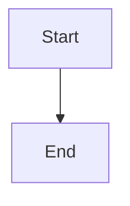

# War Room recovery status and operator guidance

## Parent Epic

epic_031

## Scope

## Outcome

Expose one durable, actionable incident state on the affected War Room row from first failure through resolution or human blocker.

## Scope

- Project recovery state through the existing API and board model.
- Show failure-specific copy, owner, safe reason, affected branch or paths, last attempt, and action/review link.
- Only claim agents are investigating after the team request is durably queued.
- Suppress duplicate warnings and repeated toasts.

## Acceptance focus

Refreshes and restarts preserve status; transitions are exact; blocked incidents name the owner and next step; resolution clears the active warning.

## Data structures

TBD.

## API contracts

TBD.

## Logic flow

## Task breakdown

_(empty — Feature Team mints tasks after dispatch)_

## Risks & upward questions

None.

## Decision log

None yet.
