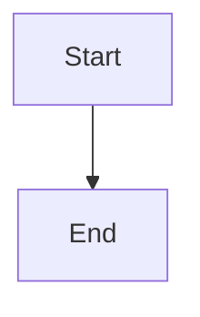

# Reconcile stacked reviews into the intended Epic branch

## Parent Epic

epic_031

## Scope

## Outcome

Keep an accepted stacked Feature review pending until its changes reach the intended Epic branch through a reviewed path, then complete and release dependents exactly once.

## Scope

- Detect when the PR target is a predecessor that has already integrated into the Epic.
- Persist the integration gap as the same recovery action model and route it to the Epic Team.
- Produce an actionable reviewed follow-up path while preserving original review provenance.
- Make reconciliation and completion idempotent.

## Acceptance focus

The feat_029_002 race is reproduced; no premature completion occurs; accepted changes reach the Epic; completion and dependent eligibility fire once.

## Data structures

TBD.

## API contracts

TBD.

## Logic flow

## Task breakdown

_(empty — Feature Team mints tasks after dispatch)_

## Risks & upward questions

None.

## Decision log

None yet.
