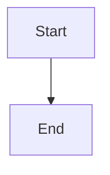

# Inventory-backed provider recovery dialog

## Parent Epic

epic_032

## Scope

# Inventory-backed provider recovery dialog

## Intent

Replace the free-text `Change provider` prompts for provider-blocked active work with a dialog that uses the same discovered provider, model, reasoning, and flex controls as brief creation, scoped to the affected Epic, Feature, or Task roles.

## Acceptance criteria

- Clicking `Change provider` on an eligible provider-blocked row opens a modal; it never asks for provider IDs or model JSON through browser prompts.
- Provider choices come from the existing normalized provider inventory. Model and optional reasoning choices update from the selected provider/model, and flex mode is shown only when supported.
- The dialog renders only the roles owned by the selected work tier: Epic Manager/Architect, Feature Lead/Architect, or SWE.
- The saved selection is visible even when now unavailable, but submission is enabled only for a currently valid complete replacement. Loading, empty inventory, refresh failure, cancel, in-flight submission, and server rejection are actionable and do not lose the operator's selection.
- Submission uses the existing human-only active-item recovery endpoint and recovery command. The server revalidates all affected roles; the client remains advisory. Success closes the dialog and refreshes the row; failure keeps the dialog open with its selections intact.
- Focused UI tests cover tier-specific roles, provider/model revalidation, unavailable saved values, flex/reasoning controls, valid payload construction, cancellation, double-submit prevention, and error retention. Existing recovery API tests continue to prove authoritative rejection, atomic mutation, and lifecycle safety.

## Constraints

Reuse the provider inventory and brief selector primitives rather than adding a static catalog or a second discovery service. Do not change recovery eligibility, lifecycle/checkpoint semantics, child selections, provider setup, retry behavior, or brief authoring. Credentials and raw provider errors must not reach the browser.

## Data structures

TBD.

## API contracts

TBD.

## Logic flow

## Task breakdown

_(empty — Feature Team mints tasks after dispatch)_

## Risks & upward questions

None.

## Decision log

None yet.
