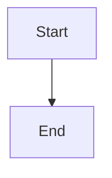

# Design guidance and configurable documentation destinations

## Parent Epic

epic_034

## Scope

Delivery slice A of epic_034; success criteria 1–2 and document-boundary constraints. epic_036 is the completed parent prerequisite.

Provide a concise design skill informed by /home/ubuntu/dev/automatik/skills and a DESIGN.md template with matching table of contents: requirements, decisions/rationale, interfaces, architecture links, and verification evidence. Preserve and reconcile the existing root design. Each requirement/decision has one owning design; parents summarize shared contracts and link to child detail. Meaningful directories own distinct behavior/state/interfaces; trivial/generated directories name their covering parent.

Extend RepositoryContext and target cascade.toml with [architecture] destination = "target" | "tracking", default target. Tracking requires epic_036's configured tracking repository. Resolve reads, proposals, links, reviews, and replay consistently. Target designs live at <code-directory>/DESIGN.md; tracking designs at design/<immutable-target-repository-key>/<code-directory>/DESIGN.md. Editable models/fragments live at architecture/<target-repository-key>/ in the selected destination. Persist stable target-directory mappings and ownership; never derive identity anew from a basename.

Acceptance: defaults, target and tracking modes, invalid combinations, root preservation, one-home references, and stable mapping after configuration changes. Existing review units must retain their fixed destination. Include focused integration checks and documentation closeout. Reuse existing configuration/routing services; no separate document service UI.

## Data structures

TBD.

## API contracts

TBD.

## Logic flow

## Task breakdown

_(empty — Feature Team mints tasks after dispatch)_

## Risks & upward questions

None.

## Decision log

None yet.
